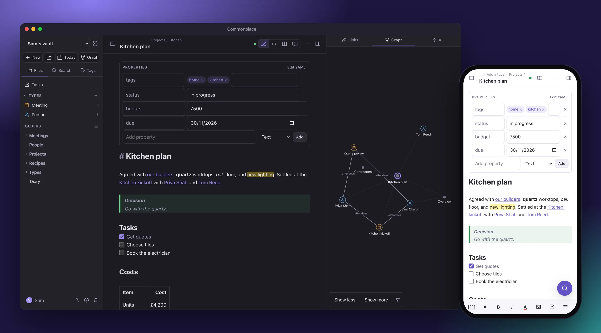

# Commonplace

**A Markdown knowledge base that several people can share, that works on your phone, and that you can always take with you as plain Markdown.**



Write in Markdown with `[[wikilinks]]`, `#tags` and properties. Edit the same note at the same time
as other people, with live cursors. Find anything by keyword or meaning. See how your notes connect
on a graph. Notes live in Postgres with pgvector, and an export is a plain folder of Markdown files
that other Markdown editors open as they are.

## Highlights

| | |
|---|---|
| ✍️ **Write** | Live Preview that renders as you type, `/` blocks and a drag handle on every block, a properties form for frontmatter, tables you edit cell by cell, callouts, Mermaid diagrams, embeds of notes, pictures and PDFs. |
| 📚 **Your library** | Name it after yourself or your team ("David's Library"). It holds **collections**, each a separate set of notes with its own members: one for home, one for work, one shared with the team. |
| 👥 **Together** | Live co-editing (Yjs CRDTs), shared collections with owner, editor and viewer roles, invitations, and version history with a diff. Offline edits merge cleanly when you reconnect. |
| 🧩 **Types** | Say what a note *is* (Person, Meeting, Book), give it a form and a template, and see every note of that type as a table, cards or a list. Stored as plain properties in the Markdown. |
| 🕸️ **Graph** | Type icons and colours, links labelled with the property they come from, filters, a graph of the open note in the side panel, and a timeline that plays your collection month by month. |
| 🔎 **Find** | Full-text, fuzzy and semantic search, fused into one list; related notes; Dataview queries (`TABLE`, `LIST`, `TASK`, `CALENDAR`, and `dataviewjs` in a sandbox). |
| 🤖 **Your own AI** | Bring an Anthropic, OpenAI, relaxAI or compatible key. It searches your notes, writes and files pages, and asks before it changes anything. Costs shown in £, with a daily limit. Or connect Claude over MCP. |
| 🐙 **GitHub** | Open a repository of Markdown as a collection. Your edits become a branch, with Review changes, Update from main and Open pull request, sent automatically if you like. |
| 🌍 **Publish** | Turn a collection, or chosen folders, into a website with a page list, contents, backlinks and tag pages. It's a snapshot, so later edits stay private until you publish again. |
| 📱 **iPhone** | Installs to the home screen, works offline, has a formatting bar above the keyboard, and has a Save to Commonplace shortcut in the share sheet. |
| 📄 **One file** | [A standalone version](standalone/README.md): one HTML file that edits a folder of Markdown files, with no server. |

The full list is in [docs/FEATURES.md](docs/FEATURES.md).

## Run it

```bash
docker compose up -d db          # Postgres 18 + pgvector on localhost:5434
cp .env.example .env             # defaults work as-is
bun install
bun run dev                      # http://localhost:3000 (hot reload)
```

Or run the whole stack in Docker with `docker compose up -d --build`. It runs in production mode,
so the first account needs a setup token: the server prints one in `docker compose logs app` (or
set `SETUP_TOKEN` yourself).

The first account you create becomes the admin and gets a collection. After that, an admin adds people
under **Settings → Admin** (or set `ALLOW_SIGNUP=true` to let anyone register). Share a collection from
**Settings (⚙) → This collection → Members**: invite their email, and they join when they accept.

### On an iPhone

The server listens on all interfaces. On the same Wi-Fi, open `http://<your-mac>.local:3000`
(for example `http://my-mac.local:3000`) in Safari, then use **Share → Add to Home
Screen**. Over plain HTTP the session cookie is not marked `Secure`. Anywhere beyond your own
network, put it behind HTTPS (Caddy, Tailscale Serve, Cloudflare Tunnel) and set
`COOKIE_SECURE=true`.

### On a laptop

`laptop/` runs the whole app on one computer, with nothing to host: `./commonplace.sh start` from
that folder builds the image, starts the app and its own Postgres on <http://localhost:8070>
(this computer only), and prints the setup token for the first account. The same script backs up,
restores, updates and packages everything into one file for a computer with no internet.
[laptop/README.md](laptop/README.md) is the full guide, for Mac, Windows and Linux.

### On Render

`render.yaml` is a Blueprint: a Docker web service plus Render Postgres (which has pgvector) in
Frankfurt, about $13 a month. It runs one instance, because live-editing rooms are held in memory.
Render generates `SETUP_TOKEN`; copy it from the service's **Environment** tab and enter it when you
create the first account, which becomes the admin. For bring your own AI, add `SECRETS_KEY` with
the Environment tab's **Generate** button (it encrypts people's API keys and GitHub tokens;
changing it means everyone re-enters theirs). Signup is off after that, so add people from
**Settings → Admin**.

### Embeddings

The `EMBEDDING_PROVIDER` setting picks the model. Every provider stores `vector(1024)`, so you can
switch at any time: notes re-embed in the background at the next boot.

| Provider | What it is |
|---|---|
| `relaxai` | `Mistral-7b-embedding` via relaxAI (needs `RELAX_API_KEY`): UK company and datacentre, £0.20 a million tokens. Its 4096 dims are cut to the first 1024, which keeps the ranking (measured in Longview and here). What production uses. |
| `hash` (default) | Offline feature hashing. No model, no network. Similarity means shared vocabulary, not meaning. |
| `voyage` | `voyage-4-lite` via the Voyage API (needs `VOYAGE_API_KEY`). Higher quality, US-hosted. |
| `ollama` | `mxbai-embed-large` on a local Ollama (`ollama pull mxbai-embed-large`). Private and semantic. |
| `none` | Keyword search only. |

If the embedding provider fails, search falls back to keywords and saving is never affected.

## Connect things

- **Claude (MCP):** Settings → Connections → Connect Claude makes a token. After one `claude mcp add` command,
  Claude Code can search, read and write your notes as you. See [docs/MCP.md](docs/MCP.md).
- **Share from the iPhone:** Settings → Connections → Share from iPhone makes a token for an Apple
  Shortcut, so **Save to Commonplace** shows in every app's share sheet. Links, text and photos go
  to an inbox note. See [docs/IPHONE-SHORTCUT.md](docs/IPHONE-SHORTCUT.md).
- **Keys:** `⌘K` lists every command, `⌘O` opens a note by name and `⌘J` opens the AI. The rest are
  in [the shortcuts page](docs/help/shortcuts.md).

## How it works

```
web/ (React + CodeMirror 6)  ──REST /api──▶  src/api.ts ─▶ notes.ts ─▶ Postgres
        │                                                     │        (notes, links, chunks
        ├──WebSocket /ws/:noteId (y-websocket protocol)──▶ collab.ts   vector(1024) HNSW,
        └──SSE /api/vaults/:id/events ◀── events.ts                    revisions, attachments)
                                                  embed.ts (debounced queue) ─┘
```

- **The Markdown is the source of truth.** Every save re-derives the title, tags, properties and
  links in the same transaction, so search and backlinks always agree with the text.
- **Each note keeps its Markdown and its CRDT state.** Changes from outside the editor are applied
  to the live room as a small diff, never rebuilt from the text.
- **One design language.** [docs/PRINCIPLES.md](docs/PRINCIPLES.md) sets the bar. Shared pieces
  live in `web/ui/` and every value in `web/styles/tokens.css`. `test/design.test.ts` keeps both in line.

[docs/ARCHITECTURE.md](docs/ARCHITECTURE.md) covers the rest: components, the data model, the key
flows, security, and the decisions behind them.

## Develop

```bash
bun run typecheck
bun test          # unit tests + an end-to-end suite that boots the server against a scratch DB
bun run test:ui   # headless-Chromium tests of the editor, file tree and Trash (needs Chrome)
bun run screens   # screenshots of the main screens, laptop and iPhone, light and dark → ./screens
bun run readme:shot      # the picture at the top of this README → docs/images/hero.webp
bun run standalone       # the one-file version → standalone/dist/commonplace.html
bun run test:standalone  # drives that file in Chrome (no database)
```

`test:ui` finds Chrome from `CHROME_PATH`, a Playwright download, or an installed Google Chrome,
and uses its own scratch database (`commonplace_ui`).

The end-to-end suite uses its own database, `commonplace_test`, which `db/init/` creates the first
time the Postgres container starts. (On a cluster created before that, run
`docker compose exec db psql -U commonplace -c "create database commonplace_test"` once.)
It drives two users through accounts, sharing, search, import and export, history, and live
co-editing, using the stock `y-websocket` client.

`scripts/make-touch-icon.ts` regenerates the iOS home-screen icon from the same shapes as
`web/icon.svg`.

## Documentation

- [Help](docs/help/index.md): the user guide, with diagrams and screenshots. The same pages are in the
  app (the ? at the bottom of the file panel, or ⌘K → Help) and in the standalone file.
- [Features](docs/FEATURES.md), [Architecture](docs/ARCHITECTURE.md) and [Principles](docs/PRINCIPLES.md).
- [Backlog](docs/BACKLOG.md) and [Changelog](docs/CHANGELOG.md).
- [Tests](test/README.md), [demo collections](demo/README.md) and [the laptop kit](laptop/README.md).
- [Contributing](CONTRIBUTING.md) and [Security](SECURITY.md).

## Licence

[MIT](LICENSE). Commonplace is built on open-source packages, each under its own licence:
see [THIRD_PARTY_NOTICES.md](THIRD_PARTY_NOTICES.md).
