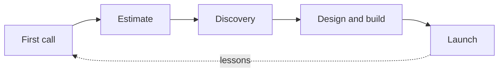

# How we work

Every project goes through the same five steps. Small ones go through them quickly.

## First call

Listen more than we talk. Afterwards, write a one-page summary and send it within a day.

## Estimate

A range, not a single number, with what's in and what's out. The studio lead signs it off.

## Discovery

A content audit and a sitemap, agreed with the client before any design starts.

## Design and build

Two-week rounds. Each ends with something the client can click, not a slide.

## Launch

Launch on a Tuesday or Wednesday, never a Friday. Write up what we learned on the project's page.
