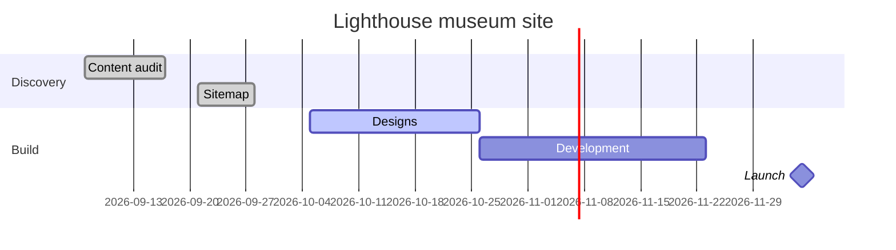

# Lighthouse museum site

## Goal

A new website for [[Seaview Museum Trust]]: opening times, tickets, and the collection online, readable on a phone in the car park.

## Tasks

- [x] Content audit of the old site
- [x] Sitemap agreed with [[Ellen Marsh]]
- [ ] Page designs for the collection
- [ ] Ticket booking hooked up

## Notes

