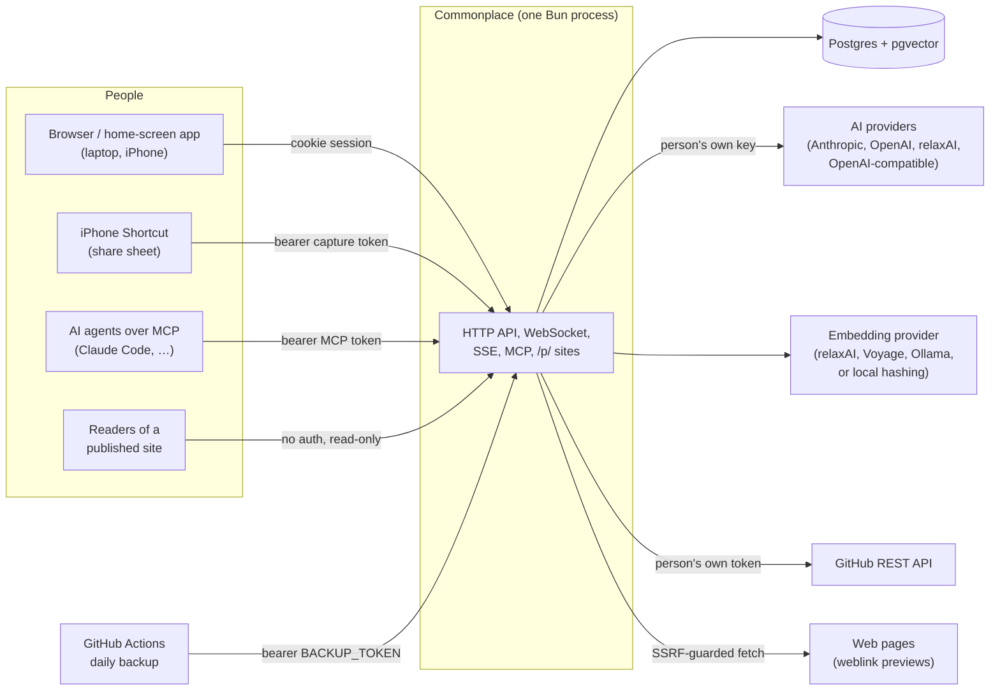
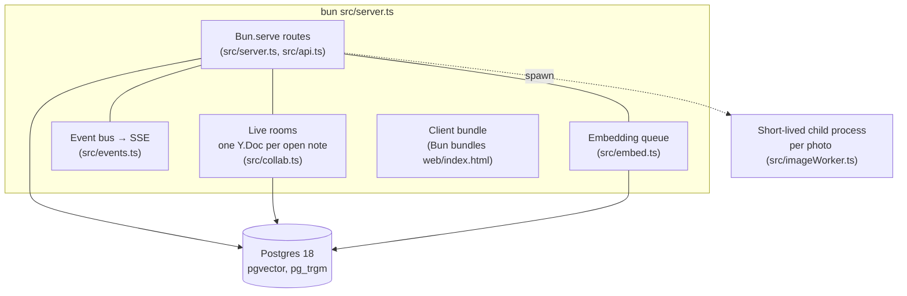
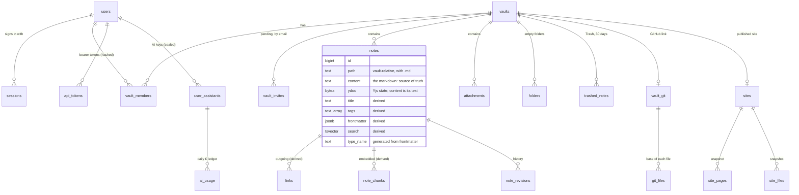
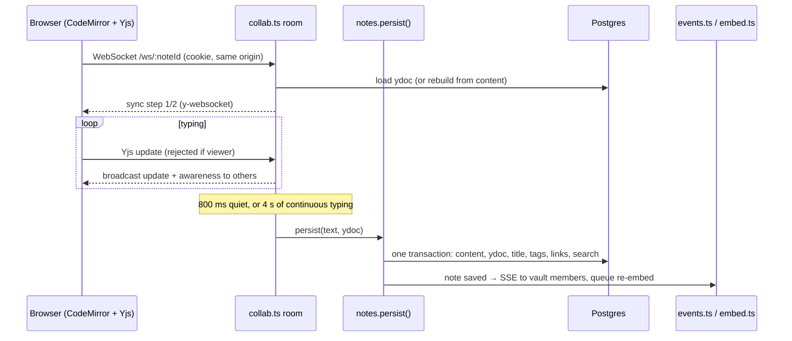
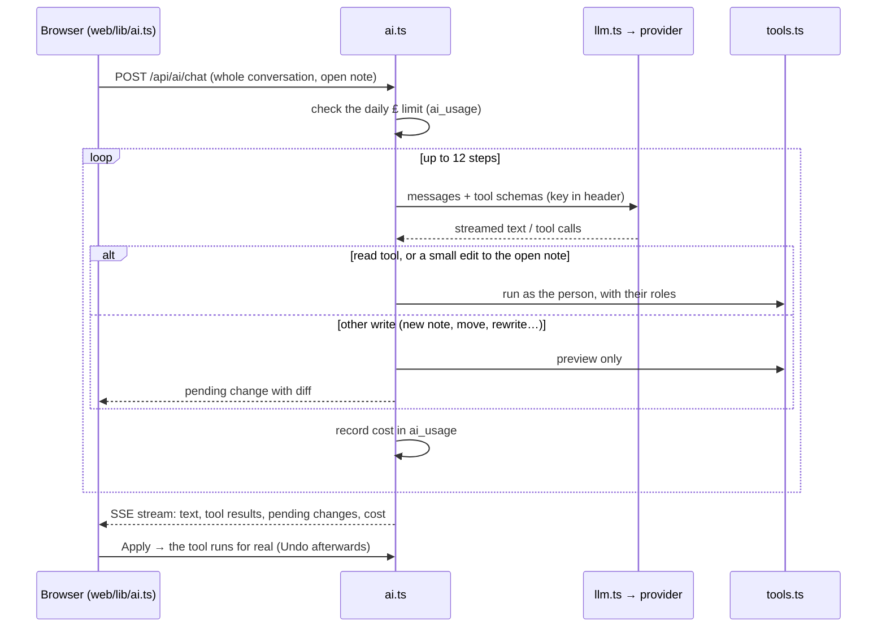

# Commonplace: high-level design

This document describes how Commonplace is built: what the parts are, how data moves between
them, and why the main decisions were taken. It is written for someone reading the code for the
first time. The [README](../README.md) describes what the app does; [PRINCIPLES.md](PRINCIPLES.md)
sets the design bar for the interface; [BACKLOG.md](BACKLOG.md) and [CHANGELOG.md](CHANGELOG.md)
record what is planned and what shipped. Feature ids such as **F14** or **N9** refer to entries
in those two files, and longer designs for finished features are in [design/](design/).

**Contents**

1. [Goals and constraints](#1-goals-and-constraints)
2. [System context](#2-system-context)
3. [Runtime and deployment](#3-runtime-and-deployment)
4. [Server components](#4-server-components)
5. [Client components](#5-client-components)
6. [Data model](#6-data-model)
7. [Key flows](#7-key-flows)
8. [Security model](#8-security-model)
9. [Operations](#9-operations)
10. [Design decisions](#10-design-decisions)
11. [Limits and known constraints](#11-limits-and-known-constraints)
12. [Reading the code](#12-reading-the-code)

---

## 1. Goals and constraints

Commonplace is a Markdown knowledge base that several people can use together,
from a laptop or an iPhone.

**Goals**

- **Plain markdown stays the truth.** Every vault exports as a zip that opens unchanged in
  other Markdown editors, and imports back. Anything the app knows (titles, tags, links, types, properties) is
  worked out from the markdown, never stored only beside it.
- **Real-time collaboration.** Two people typing in the same note see each other's cursors, and
  their edits merge character by character, including edits a phone made offline.
- **One small server.** A single Bun process and one Postgres database run the whole service on
  a small hosting plan (Render's starter tier: 512 MB of memory and a 1 GB database disk).
- **Safe to share.** Viewers can't write anywhere, people outside a vault can't tell that it
  exists, and a published website can reach only what was published.
- **People bring their own keys.** AI assistants and GitHub use each person's own credentials,
  which are encrypted at rest and never sent back to the browser.

**Non-goals (for now)**

- Horizontal scaling. Live-editing rooms are held in memory, so the service runs exactly one
  instance (see [§10](#10-design-decisions)).
- Being a multi-tenant SaaS. One deployment serves a household or a small team, with an admin
  who manages accounts.
- Running editor plugins. Commonplace reads and writes the markdown that common plugins
  produce (Highlightr colours, Bases views, callouts) but doesn't run plugin code.

## 2. System context



Each kind of client authenticates differently, and none of them ever puts a credential in a URL:

| Client | How it authenticates | What it can reach |
|---|---|---|
| Browser | Session cookie (`HttpOnly`, `SameSite=Lax`), same-origin check on writes and socket upgrades | The vaults the person belongs to, with their role in each |
| iPhone Shortcut | `Authorization: Bearer cpc_…` capture token | Append to one inbox note in one vault, nothing else |
| MCP agent | `Authorization: Bearer cpm_…` MCP token, read-only or read-write | The tools in `src/tools.ts`, as the person, with their roles |
| Backup job | `Authorization: Bearer $BACKUP_TOKEN` | `GET /api/backup` only |
| Site reader | None | The published snapshot at `/p/<slug>/` only |

## 3. Runtime and deployment



- **One process does everything.** `src/server.ts` starts `Bun.serve` with the JSON API, the
  WebSocket for live editing, server-sent events, the MCP endpoint and published sites. Bun
  bundles the React client straight from `web/index.html`, so there is no separate build step
  (and `bun run dev` hot-reloads both halves).
- **Boot is idempotent.** `src/migrate.ts` applies `db/schema.sql` at every start. The schema is
  written only with `create … if not exists` and `add column if not exists`, so a deploy is just
  a restart. Boot then tidies Trash and old versions (again every six hours), and queues any
  notes whose embeddings are missing or stale.
- **Shutdown flushes.** On `SIGTERM` every open room saves before the process exits, with a time
  limit so a stuck save can't outlast the host's 30-second grace period.
- **Deployment.** `Dockerfile` builds a slim Bun image, and `render.yaml` describes the Render
  Blueprint: one starter web service and one Postgres database in Frankfurt.
  `docker-compose.yml` runs the same pair locally. `laptop/` is a kit for running it on one
  computer with no server: its own compose project (app plus Postgres, bound to 127.0.0.1, data in
  the `commonplace-laptop-data` volume) and `laptop/commonplace.sh`, which makes the `SECRETS_KEY`,
  shows the setup token, backs up with `pg_dump`, restores, resets a password
  (`scripts/reset-password.ts`) and packages both images into one file for an offline install.

Configuration comes only from environment variables (`src/settings.ts`, documented in
`.env.example`). No secret is ever committed.

## 4. Server components

All server code is in `src/`. Most modules are small and own one concern.

| Area | Modules | Responsibility |
|---|---|---|
| **Entry and routing** | `server.ts`, `api.ts` | Static routes, the WebSocket upgrade and `/p/*`. `api.ts` declares every `/api` route through one `route()` wrapper, which maps `HttpError` to JSON, enforces same-origin on writes and parses ids. |
| **Identity** | `auth.ts`, `tokens.ts`, `vaults.ts` | Accounts (argon2id), server-side sessions, bearer tokens (stored hashed, with scopes), vault membership, invitations (accepted before they grant anything) and roles (`owner`, `editor`, `viewer`). |
| **Notes core** | `notes.ts`, `markdown.ts`, `props.ts`, `ydoc.ts` | Create, read, update and delete notes. `persist()` re-derives the index in the same transaction. Also revisions, Trash and link resolution. `markdown.ts` is pure and shared with the browser. |
| **Live editing** | `collab.ts`, `events.ts` | Yjs rooms over the standard y-websocket protocol, with awareness (cursors). Debounced persistence. A vault-level event bus streamed to browsers over SSE. |
| **Search** | `search.ts`, `embed.ts` | Full-text search (title-weighted), trigram title search and pgvector similarity over heading-sized chunks, fused with Reciprocal Rank Fusion. Embedding runs in a debounced in-process queue. |
| **Structure** | `types.ts`, `typeIndex.ts`, `vaultViews.ts`, `tour.ts` | Types defined as notes in `Types/`, type pages and relations, tasks across the vault, unlinked mentions, bookmarks, and the first-run tour. |
| **Import / export** | `transfer.ts` | Import a zip or folder of Markdown files, export a vault or a note, and the streamed backup zip. Limits on size and entry counts guard against zip bombs. |
| **Capture** | `capture.ts`, `weblinks.ts`, `images.ts`, `imageWorker.ts`, `imageMath.ts` | The iPhone share target. Weblink notes come from an SSRF-guarded fetch, and photos are converted (HEIC to JPEG, shrunk, upright) in a child process. |
| **AI** | `ai.ts`, `llm.ts`, `tools.ts`, `mcp.ts`, `assistants.ts`, `prices.ts`, `secrets.ts` | Each tool is defined once in `tools.ts`. `mcp.ts` serves the tools to agents over MCP. `ai.ts` runs them in-process for the in-app assistant. `llm.ts` translates to each provider's format. `assistants.ts` holds sealed keys and daily £ limits. |
| **GitHub vaults** | `git.ts`, `github.ts`, `merge3.ts`, `gitAuto.ts`, `schedule.ts` | Copy in, track changes, push and open a PR, update from the base with a three-way merge, and cancel; send on a schedule, once idle, or straight to a branch (F19). Uses the REST API only. |
| **Publishing** | `publish.ts` | Renders a snapshot of the chosen notes to HTML in `site_pages` and `site_files`, then serves `/p/<slug>/` from that snapshot. |
| **Guards** | `storage.ts`, `settings.ts` | The disk guard (warns at 80%, refuses new data at 90%; typing is never refused) and the environment settings. |

Two rules hold across the server:

1. **Every note write goes through `notes.persist()`**, and every write from outside the editor
   goes through `notes.overwriteContent()`. A write from elsewhere is applied as a diff to the
   open room, if the note has one, so it reaches people who are typing instead of being undone
   by their next keystroke.
2. **Every route that writes calls `vaultCtx(ctx, "editor")`** (or `"owner"`). A non-member gets
   404, never 403.

## 5. Client components

The client is in `web/`: React 19 for the screens and CodeMirror 6 for the editor, with no
framework beyond that.

| Layer | Where | What lives there |
|---|---|---|
| **Shell** | `App.tsx`, `main.tsx`, `lib/router.ts` | Signed-in state, the open vault and note, client routing, layout (sidebar, note, right panel), the event-stream subscription. |
| **Screens** | `components/` | One file per screen or panel: `NoteView` and `Editor`, `Sidebar`, `Settings` and its sections, `TypePage`, `TasksPage`, `Graph`, `AiChat`, `ChangesPage`, and so on. |
| **Editor extensions** | `lib/livePreview.ts`, `lib/propertiesWidget.ts`, `lib/tableWidget.ts`, `lib/blockHandle.ts`, `lib/blocks.ts`, `lib/embeds.ts`, `lib/colours.ts` | Live Preview built as CodeMirror decorations and widgets. Blocks are worked out from the syntax tree and never stored. |
| **Shared logic** | `lib/commands.ts`, `lib/links.ts`, `lib/render.ts`, `lib/frontmatter.ts`, `lib/offline.ts`, … | The single command registry (⌘K, the ⋯ menu and the `/` menu all read it), link resolution that mirrors the server, sanitised rendering (DOMPurify), surgical frontmatter edits, and the offline store. |
| **Design system** | `ui/`, `styles/` | `Modal`, `Menu` (a popover on a laptop, an action sheet on a phone), the app's own confirm, prompt and toasts (`overlays.tsx`), and icons. Every colour, size, radius and duration is a token in `styles/tokens.css`, with one stylesheet per area. `test/design.test.ts` enforces both. |
| **Offline** | `sw.js`, `lib/offline.ts` | A network-first service worker that caches the app shell and a short allow-list of reads. Each opened note's Yjs state is kept in IndexedDB. |

The browser and server share `src/markdown.ts`, `src/types.ts` and `src/prices.ts`, so a
wikilink, a type or a price means the same thing on both sides.

**The standalone version** (`standalone/`) is the same client built into one HTML file that edits
a folder of Markdown files with no server. Its build swaps `web/lib/api.ts` for a stand-in that
reads the open folder, and reuses Live Preview, the renderer, embeds, dialogs and stylesheets as
they are. Chrome and Edge write changes back through the File System Access API; other browsers
keep edits in the tab and download them as a zip. See `standalone/README.md`.

**Help** (`docs/help/*.md`, `web/lib/help.ts`, `web/components/Help.tsx`): the user guide is
Markdown pages with Mermaid diagrams and screenshots, read on GitHub as they are and bundled into
the client as text, where the note renderer draws them in a Settings-like screen (the ? in the
file panel, or ⌘K → Help). The app serves the pictures at `/help/images/`; the standalone build
swaps `web/lib/helpImages.ts` for a module with the pictures of its own pages (those marked
`standalone: true`) inside the file. `bun run help:shots` retakes the pictures from the real app,
and `test/help.test.ts` checks that every page, link and picture is there and that the shortcuts
page lists every command's shortcut.

**Mermaid diagrams** (`web/lib/mermaid.ts`): the renderer turns a ```` ```mermaid ```` block into a
placeholder holding its source, and the embed step (reading view) or a Live Preview widget draws
it. Mermaid's own browser build isn't bundled: the app serves it at `/vendor/mermaid.js`
(`web/lib/mermaidLib.ts`), and the standalone file carries it gzipped, so it loads only for a
note with a diagram. It runs in strict mode, its SVG is sanitised again, and each diagram sits in
a shadow root, so the stylesheet inside it can't restyle the app.

**Dataview** (`src/dataview.ts`, shared by server and browser): a parser and interpreter for
Dataview's query language over "pages" read from each note (frontmatter, inline fields, tags,
links, list items and tasks), with links resolved by the app's rules and backlinks worked out
across the vault. It interprets queries and never runs a note's code: a step budget stops a
runaway query, and patterns that could backtrack forever aren't run. `$= dv.pages(…)…` is read
as an expression in the same language (JavaScript's `==`, `&&`, `.where`, `.includes` and
`.length` have equivalents), so nothing is evaluated as JavaScript. Where it runs:

| Version | Pages from | Runs |
|---|---|---|
| App | `src/dataviewVault.ts`: each vault's notes, reread only when changed | on the server, `POST /api/vaults/:v/dataview` (viewers and up) |
| Standalone | the open folder (`standalone/api-shim.ts`) | in the browser |
| Published site | the published notes only | at Publish (`src/publish.ts`), frozen into the page as HTML |

The renderer leaves a placeholder; `web/lib/dataview.ts` asks for a note's results in one request,
shows them with `src/dataviewRender.ts`, and asks again when the vault's notes change. **dataviewjs** runs a note's JavaScript, which nothing else in the app does, so it runs only inside
a sandboxed frame per block (`sandbox="allow-scripts"`, an opaque origin) on a page of its own
(`src/sandbox.ts`, served at `/sandbox/dataviewjs`; the standalone file carries the same page and
uses `srcdoc`). That page's policy allows its own script (pinned by hash) and `eval` for the note's
code, and no network, images, fonts or forms from anywhere, so the code can't reach the app's
cookies, storage or pages and what it reads can't leave. The frame gets the vault's pages
(`GET /api/vaults/:v/dataview/pages`, viewers and up) and builds Dataview's `dv` API on the same
engine (`web/sandbox/dvjs.ts`). It asks the app for anything else by message, each checked in
`web/lib/dataviewjs.ts`: open a note, tick a task (as the reader), read a note or file of the vault
(`GET …/dataview/file`), open an http(s) page, set its height. Before it runs, every loop in
the code gets a guard call (`web/sandbox/loopGuard.ts`, using acorn) that throws once the script
has held the thread for 5 seconds without a break, so an endless loop can't freeze a tab whose
sandbox shares the page's process; the app also pings each frame and closes one that stops
answering for 10 seconds. **At Publish** the owner's browser runs every published block the same
way, unseen (`freezeDataviewJs`): `GET …/site/dataviewjs` gives the blocks and the published
notes only, `GET …/site/dataviewjs/file` reads only published notes, the site's files and views'
`.js`/`.css`, and the frame sends back what it drew. The server keeps a few tags and safe
attributes of it (`cleanFrozen` in `src/publish.ts`), turns note links into page links (or plain
words when not published), and freezes it into the page; a block that didn't run shows its code. A
`CALENDAR` result is the dated notes; the app draws one month with buttons to move and pick a
day, and a published page every month that has notes, with no buttons. Dates are
wall-clock times in the reader's time zone, which the browser sends.

## 6. Data model

`db/schema.sql` is the full schema; each table there has a comment saying what it holds. The
core of it:



- **Derived columns are rebuilt on every save.** Title, tags, frontmatter, links, the search
  vector, aliases and type are worked out from `content` in the same transaction that saves it.
- **Links are stored unresolved.** `links.target` is the link as written, normalised (lower case,
  no `.md`, no `#heading`). It is resolved at query time: exact path first, then title, then path
  suffix, then alias or id. A link to a note that doesn't exist yet starts working as soon as
  the note is created.
- **`content` and `ydoc` are kept together.** `content` is always the text of `ydoc`. A null
  `ydoc` means "rebuild from `content` on next open", which is safe only when no client holds an
  older state.
- **Embeddings are `vector(1024)` for every provider** (longer vectors are truncated), behind an
  HNSW index. `embedded_hash` records which provider and content produced them, so switching
  providers re-embeds in the background.
- **Invitations are not memberships.** `vault_invites` holds pending invitations by email (so
  one can wait for an account that doesn't exist yet); only Accept inserts into `vault_members`,
  and every access check reads `vault_members` alone, so a pending invitation grants nothing.
- **Snapshots are separate from live data.** Trash, revisions, the GitHub base (`git_files`) and
  published sites (`site_pages`, `site_files`) are their own tables. Live queries never need to
  filter them out, and the published site never reads from `notes`.

## 7. Key flows

### 7.1 Opening and editing a note



The client also keeps the note's Yjs state in IndexedDB. Offline edits accumulate there and merge
through the same sync protocol when the socket reconnects. Because the server never replaces a
room's document with one rebuilt from text, the two histories merge instead of duplicating.

### 7.2 Writes from outside the editor

REST saves, imports, restores, agents' tools, iPhone captures and GitHub updates all call
`overwriteContent(note, textOrFunction)`:

- If the note has an open room, the change is computed as a minimal text diff and applied to the
  live `Y.Doc` (`ydoc.ts: applyTextDiff`). Everyone in the room sees it arrive.
- Otherwise the diff is applied to the stored CRDT state (`rebaseStoredDoc`), and the result is
  persisted.
- An append passes a function, not text, so it is computed against the latest content and can't
  undo someone's concurrent typing.
- Automated writers (agents, the in-app assistant, GitHub) keep one revision per burst, so
  Version history shows the note as it was before the burst rather than one entry per call.
- Writes that add data first call `assertRoom(bytes)`, the storage guard.

### 7.3 Search

`GET /api/vaults/:v/search?q=` parses `tag:` and `path:` filters out of the query, then runs two
queries in parallel:

- **Keyword:** Postgres full-text search (with the title weighted higher) plus trigram title
  matches.
- **Meaning:** pgvector cosine similarity between the query's embedding and the vault's chunks.

The two rankings are fused with Reciprocal Rank Fusion (k = 60), so neither scoring scale
dominates. If embeddings are off or the provider fails, search returns the keyword results
alone. A failed embedding never fails a save.

### 7.4 An AI assistant turn



The server keeps no conversation state: the browser sends the whole conversation each turn. MCP
agents call the same `tools.ts` functions through `mcp.ts`. Since those agents have no approval
step, a read-only token exposes only the read tools.

### 7.5 GitHub vaults

A vault can be a copy of a repository, or of one folder in it. The workflow is a branch and a
pull request; nothing reaches the base branch directly unless an owner chooses to publish
straight to it (step 6).

1. **Copy in.** The Trees and Blobs APIs read only markdown, canvases and attachments. Each
   file's base is recorded in `git_files`: repo path, blob SHA, an md5 and, for notes, the text.
2. **Changes.** Changed files are worked out on request by comparing the md5 of each live row
   with its base. An added file identical to a deleted one counts as a move.
3. **Push.** The server creates blobs, then a tree built on the base tree (so code,
   dot-folders and anything else not copied can't change), then a commit, then the branch ref.
   The first push opens a PR.
4. **Update from the base.** Unchanged notes update in place. Notes changed on both sides merge
   line by line (`merge3.ts`). A real clash waits in `git_clashes`; conflict markers are never
   written into a note.
5. **Cancel.** Every note goes back to its base through `overwriteContent`.
6. **Sending on its own (F19, `gitAuto.ts`, `schedule.ts`).** An owner picks a mode per vault,
   stored on `vault_git`: ask (step 3 by hand), a PR on a UK-time schedule, each note pushed once
   idle, or a commit straight onto the base branch. A once-a-minute check runs whatever is due
   with the token of the owner who chose (`send_as`), and stores `next_run_at`, so a restart loses
   nothing and a missed run happens once. Each run merges first (step 4); a clash, a sender who
   can't send any more, or a refusal from GitHub pauses it with the reason, and a busy or
   unreachable GitHub is retried later. Notes held back (`git_held`) stay out, and a push keeps
   whatever an earlier push left on the branch for them (`git_pushed.sha`). After a PR merges,
   a note whose text there is exactly what was pushed takes the local text without a merge.

There is no git binary or clone URL anywhere. The token travels only in the `Authorization`
header.

### 7.6 Publishing a website

1. The owner chooses folders in Settings. The choice is saved in `publish.json` at the top of the
   vault, an ordinary file, so it travels with an export or a repo. A note with
   `publish: false` stays out.
2. **Publish** renders each chosen note to HTML on the server:
   - Wikilinks are resolved against the whole vault. A link to a note that isn't published
     becomes plain text, so its title isn't revealed.
   - Comments, block ids and frontmatter are stripped.
   - Raw HTML is cut down to formatting tags with no attributes.
   - The pages, and copies of the files they show, are written to `site_pages` and `site_files`
     in one transaction.
3. `/p/<slug>/…` is served from those two tables only, with a CSP that allows no script and
   sandboxes the page, plus `noindex`. The slug is random. Every miss returns the same 404.
4. **Take down** sets `live = false` and keeps the snapshot, so Undo can restore it.
5. **Features** (the builder, F18 step 2) are switched on in `publish.json` (`features`). At
   Publish each page's details go into `site_pages.meta`: its contents list, the published pages
   linking to it, its tags, when it changed and its word count, all from the text the page shows.
   The page list, tag pages and the light and dark switch are drawn when a page is served; the
   switch is links to `_site/theme`, which sets a cookie scoped to the site's path and comes back.
6. **The preview** (`GET /api/vaults/:v/site/preview/…`, owners) draws the same pages with the
   same code (`respond` in `publish.ts`) from the notes as they are and the current
   `publish.json`, so it shows a change before Publish. It is framed by Settings → Website with
   `sandbox="allow-same-origin"`: same origin, so the owner's cookie reaches its links and files,
   but no scripts, forms or popups, and its CSP allows no script either.

### 7.7 Capture from the iPhone

The Shortcut posts to `/api/capture` with its token. The server appends each item as a to-do in
the token's inbox note, through `overwriteContent`:

- A shared URL becomes a Weblink note, from a fetch with an 8 s timeout, a size limit, at most 3
  redirects, and no private or metadata addresses (checked again at every redirect).
- A photo is converted in a child process, which returns the decoder's memory to the system
  when it exits.

## 8. Security model

| Concern | Approach | Where |
|---|---|---|
| Passwords | argon2id (`Bun.password`). Login compares against a dummy hash for unknown emails, so timing doesn't reveal accounts. | `auth.ts` |
| Sessions | A random token in an `HttpOnly`, `SameSite=Lax` cookie, `Secure` behind HTTPS. Only its SHA-256 is stored. Signing out or deleting a user closes their sockets and streams at once. | `auth.ts`, `api.ts` |
| CSRF | Writes and WebSocket upgrades must come from the same origin. A request with no `Origin` header comes from a non-browser client, which has no ambient cookie to abuse. | `auth.ts: sameOrigin` |
| Authorisation | Roles per vault, checked on every route and on every WebSocket sync message. Viewers are read-only everywhere. Non-members get 404. | `vaults.ts`, `api.ts`, `collab.ts` |
| Consent to share | Nobody is added to a vault without accepting: an owner's invite creates a pending row in `vault_invites` that grants no access (notes, search, events, sockets, tokens, MCP and the in-app AI all read `vault_members`). The reply is the same whether or not the email has an account, so it doesn't reveal who has one. An invitation closes if its sender stops being an owner. | `vaults.ts`, `api.ts` |
| Bearer tokens | Prefixed (`cpc_`, `cpm_`), stored hashed, scoped, revocable, shown once, never accepted in a URL. | `tokens.ts` |
| Secrets at rest | People's AI keys and GitHub tokens are sealed with AES-256-GCM under a key derived from `SECRETS_KEY`. They are never returned to the browser (only the last four characters are shown) and never included in backups. | `secrets.ts`, `assistants.ts` |
| XSS in the app | Rendered markdown goes through DOMPurify; dataviewjs code runs only in a sandboxed, opaque-origin frame with no network (`src/sandbox.ts`), and what it drew for a published page is cut down to a few tags and attributes on the server; Dataview results are built from escaped values and sanitised Markdown, and never run a note's code; Mermaid runs in strict mode, its SVG is sanitised and shadow-rooted, and a note's `%%{init}%%` can't add CSS. Attachments are served with `nosniff` and a sandboxing CSP, so an uploaded SVG can't run script. | `web/lib/render.ts`, `api.ts` |
| Security headers | The app's page has a CSP: scripts only from the bundle's own files (`'unsafe-inline'` only in development, for Bun's dev script), inline styles (React, CodeMirror), images from `https:` (remote images in notes), connections to itself and its own ws/wss. Nothing may frame it (`frame-ancestors 'none'`, `X-Frame-Options`). Every app response has `nosniff`, `Referrer-Policy: same-origin` (a remote image never learns which note it's in) and, when the cookie is `Secure`, HSTS. Bun's HTML-bundle route takes no headers, so the bundle is mounted at a random private path and `"/*"` serves its HTML with them. | `server.ts` |
| XSS on sites | Pages are rendered on the server with a tag allow-list and no attributes, and served with a no-script, sandboxed CSP. | `publish.ts` |
| SSRF | Weblink fetches allow only http(s) on the standard ports and refuse private, loopback, link-local and metadata addresses, re-checked at every redirect. Assistants' base URLs can't be local in production unless `ALLOW_LOCAL_AI` is set, and are resolved and checked again at every call. Both connect to the address that was checked (Host header and TLS server name set to the name, so the certificate is checked as usual), never to a second lookup, so DNS rebinding can't get past the check. | `egress.ts`, `weblinks.ts`, `llm.ts`, `assistants.ts` |
| Resource abuse | Limits on note size (5 MB), file and upload size (25 MB), zip entries and expanded size, WebSocket messages (16 MB), tool-loop steps, and image megapixels. A daily £ limit per assistant. | `storage.ts`, `transfer.ts`, `ai.ts`, `imageWorker.ts` |
| First account | The first account becomes admin. When `SETUP_TOKEN` is set (the Render Blueprint generates one), creating it needs that token, so a fresh deploy can't be claimed by a stranger. Set it on any public deploy. | `auth.ts` |

To report a vulnerability, see [SECURITY.md](../SECURITY.md).

## 9. Operations

- **Health:** `GET /health` runs `select 1` and is the hosting health check.
- **Backups:** `GET /api/backup` (bearer `BACKUP_TOKEN`) streams every vault as markdown, plus
  history, members and Trash as JSON. `.github/workflows/backup.yml` fetches it daily and keeps
  14 days. `scripts/restore.ts` restores a backup into the database at `DATABASE_URL` (into an empty one, it creates the owner as admin). Passwords, AI keys,
  GitHub tokens and GitHub links are deliberately left out of backups. The laptop kit backs up the
  whole database instead (`./commonplace.sh backup`), since there's no server to fetch from.
- **Storage guard:** the database's size is checked (cached for a minute) against `DB_DISK_GB`.
  At 80% admins see a warning. At 90%, new notes, files, imports and agents' edits are refused
  with a message saying why. Typing in open notes is never refused.
- **Retention:** Trash keeps notes for 30 days, and each note keeps its newest 100 versions,
  with a snapshot at most every 10 minutes of editing.
- **Performance:** `bun run bench` imports a large synthetic vault and checks the main queries
  against time budgets.
- **Logs:** plain `console` lines for boot, tidying, shutdown and errors. Tokens and keys are
  never logged.

## 10. Design decisions

| Decision | Why | Trade-off accepted |
|---|---|---|
| **Markdown is the source of truth; the index is derived in the same transaction.** | Export to plain Markdown always round-trips, and search and backlinks can't drift from the text. | Every save re-parses the note. That is cheap at note sizes, and capped at 5 MB. |
| **Diff into the CRDT; never rebuild it from text.** | Rebuilding gives a document with a new history, and Yjs would duplicate text when an offline client merged its old one. | Writes from outside the editor are a little more involved (`ydoc.ts`). A regression test guards this. |
| **Postgres for everything** (notes, files, vectors, sessions, snapshots). | One thing to back up, restore and reason about; pgvector and full-text search sit beside the data, so there's no index to keep in sync. | Files are kept in the database, so the storage guard matters. Photos are shrunk before they're stored. |
| **A single instance with in-memory rooms.** | Live editing needs every editor of a note on the same document. One process avoids a pub/sub layer and keeps the hosting cost to about $13 a month. | No horizontal scaling, and a restart reconnects live sessions. Moving rooms to a shared store is the path if that's ever needed. |
| **No build step** (Bun bundles `web/index.html`). | One command runs everything, and dev and production run the same code path. | The project is tied to Bun's bundler. |
| **Types are notes** (`Types/Person.md`) and views are `.base` files. | Everything stays plain, portable markdown. | A type's schema is only as strict as its frontmatter. |
| **The GitHub REST API, not git.** | No binary, no clone URLs, no working copies on a small disk. Pushing on the base tree guarantees untouched files stay untouched. | Large repos are capped (5,000 files), and the merge is line-based. |
| **Publishing is a snapshot**, served from its own tables. | The published site can't reach unpublished notes even by mistake, and edits stay private until republished. | A deleted note stays published until the next Publish. Settings lists it under "To take down". |
| **One tool definition for MCP and the in-app assistant.** | One audited set of capabilities, always running as the person with their roles. | Tools must stay provider-neutral. |
| **404, not 403, for other people's vaults.** | Doesn't reveal that a vault or note exists. | Slightly less helpful errors. |
| **The app's own dialogs and one token set.** | One consistent design language on laptop and phone ([PRINCIPLES.md](PRINCIPLES.md)). | Every new UI must use `web/ui/` and the tokens; tests enforce it. |

Rejected approaches are recorded under **Decided against** in [BACKLOG.md](BACKLOG.md).

## 11. Limits and known constraints

- One server instance, with live rooms in memory (see above).
- Notes are at most 5 MB, and files and attachments at most 25 MB.
- Imports allow at most 50,000 entries and 1 GB expanded; GitHub vaults at most 5,000 files.
- Embeddings are fixed at 1024 dimensions. Changing that needs a migration and a re-embed.
- Published sites are unlisted (a random slug and `noindex`), not access-controlled: anyone with
  the link can read them.
- The in-app assistant runs at most 12 tool steps per turn, and each assistant has a daily £
  limit.

## 12. Reading the code

A suggested order for a first read:

1. `db/schema.sql`: the data, with a comment on each table.
2. `src/markdown.ts`: what the app understands in a note.
3. `src/notes.ts` (`persist`, `overwriteContent`, `resolveLink`) and `src/ydoc.ts`: the core write
   path.
4. `src/collab.ts`: live editing.
5. `src/api.ts`: every route, the `route()` wrapper and `vaultCtx`.
6. `web/App.tsx`, then `web/components/NoteView.tsx` and `web/components/Editor.tsx`: the client.
7. `web/lib/commands.ts`: every user action in one list.
8. Any feature module: `tools.ts` and `ai.ts`, `git.ts`, `publish.ts`, `search.ts`.

The tests are a good map of behaviour. `test/e2e.test.ts` boots the server against a scratch
database and drives two users through every feature, and `test/ui/` drives headless Chrome. See
[test/README.md](../test/README.md).
