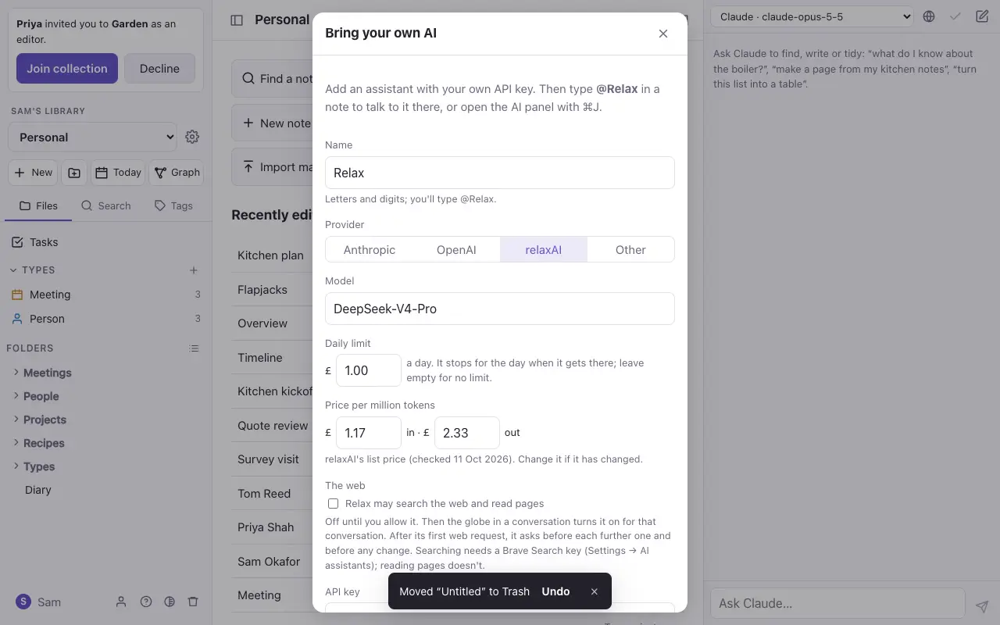
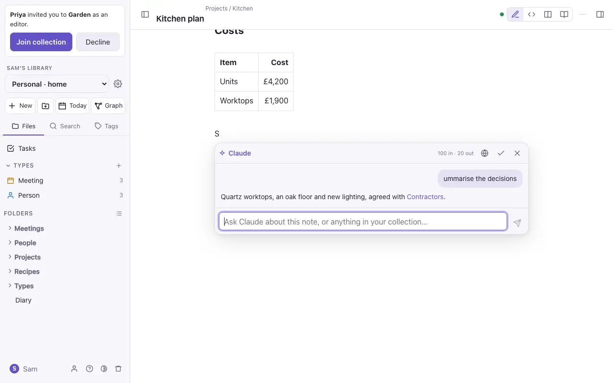
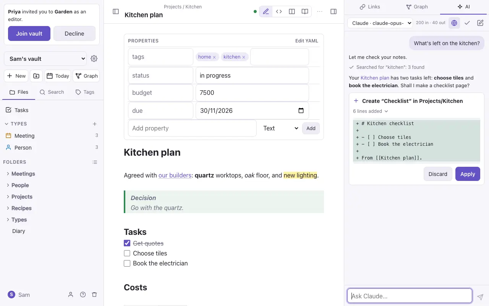

# AI assistants

Commonplace has no AI of its own. You add an assistant with your own key from an AI provider, and you pay that provider for what you use. Your key is stored encrypted, never shown again and never shared with other members.

## Adding an assistant

Settings → **AI assistants** → **Add an assistant** (or **Add an AI** in `⌘K`). Choose a provider (Anthropic, OpenAI, relaxAI or any OpenAI-compatible service), paste your key and pick a model.

Each assistant has a **daily limit** in pounds, £1 unless you change it. Every conversation shows what it cost, and when the day's limit is reached the assistant stops until tomorrow.

## Asking in a note

Type `@` and the assistant's name (such as `@Claude`) on a new line, then your question. The answer appears under the line. **✓** keeps it in the note as a folded callout; **✗** throws it away.

## The AI side panel

`⌘J` opens a conversation in the side panel that stays with you as you move between notes. The assistant can:

- **Find and answer**: search your notes and answer with links to them.
- **Write**: make new pages from what it finds.
- **Organise**: reformat a note, fill in properties, move notes, split a long note, or file notes into your [types](types.md).
- **Drive the app**: open a note, show the graph or hide a panel.

Changes to the open note happen straight away, and stay in its version history. Anything else, such as a new page or a change to another note, shows what it would change, with **Apply** and **Discard**, and Undo afterwards.

## Connecting Claude

Settings → **Connections** → **Connect Claude** makes a personal token, so Claude Code and other agents can search, read and write your notes as you, over MCP. The screen shows the command to run. An agent has your roles: it can't see vaults you can't, and it can't write where you're a viewer.
