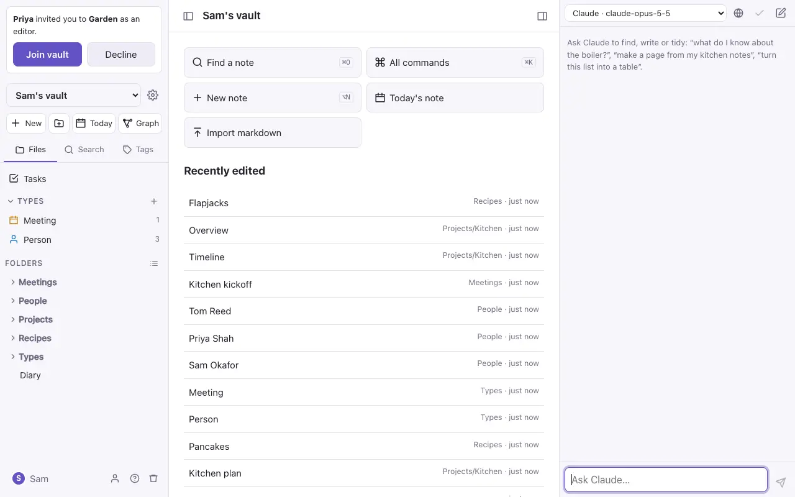
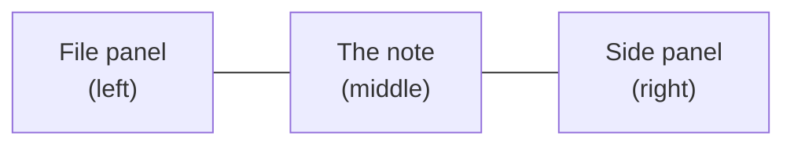
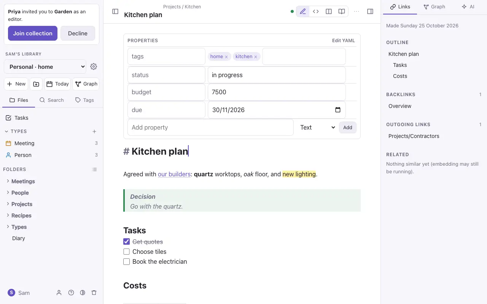

# Getting started

## Signing in

The first account made on a new server becomes the **admin**, and it gets a vault to start with. After that, an admin adds people in Settings → Admin. Or someone who already has a vault can invite you by email; see [Sharing and live editing](sharing.md).

## Vaults

A **vault** is a collection of notes and the folders they're in. You can have several vaults, such as one for home and one for work, and each one has its own members. Pick a vault from the menu at the top of the file panel, or make a new one there.

## The screen

- **The file panel** (left): the vault menu, buttons for a new note, a new folder, today's note and the graph, and three tabs: **Files**, **Search** and **Tags**. Under Files are **Tasks**, your **types** and your **folders**. Your name at the bottom opens Settings, and the bin opens Trash. `⌘\` shows or hides it.
- **The note** (middle): its folder and title at the top, the view buttons (Live Preview, Source, side by side and Reading), the **⋯** menu for this note, and the text.
- **The side panel** (right): the **Links** tab (outline, backlinks, outgoing links, mentions and related notes) and the **AI** tab. The button at the top right shows or hides it.

To make either panel wider (handy for the graph in the side panel), drag its inner edge. Double-click the edge to put it back. With the keyboard, Tab to the edge and use the arrow keys. Each browser remembers the widths. On a phone the panels are drawers, so there's nothing to drag.

On a phone the two panels slide in from the sides; see [On the iPhone](iphone.md).

## Your first note

1. Press **New** (or `⌥N`). A note called *Untitled* opens.
2. Click the title to rename it.
3. Type. Notes save as you go: there's no Save button.
4. Type `[[` to link to another note, `#` to add a tag, or `/` at the start of a line for headings, lists, tables and more.

Next: [Writing notes](writing.md).

> [!tip] Everything is in ⌘K
> `⌘K` opens a list of every command: what you can do with this note, what you can make, and where you can go. Type a few letters to find one. On a phone, the **⋯** menu has the note's commands.
