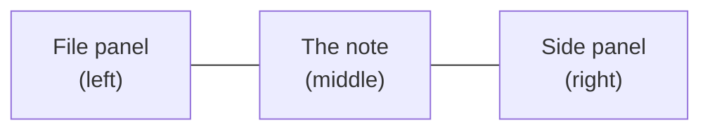

# Getting started

## Signing in

The first account made on a new server becomes the **admin**, and it gets a collection to start with. After that, an admin adds people in Settings → Admin. Or someone who already has a collection can invite you by email; see [Sharing and live editing](sharing.md).

## Your library and its collections

Everything on a server is one **library**, such as *David's Library* or *Team Library*. Its name sits at the top of the file panel. At first it's named after the first admin, and an admin can rename it in Settings → Admin.

A library holds **collections**. A collection is a set of notes and the folders they're in. You might have one for home and one for work, and each has its own members, so sharing one collection doesn't share the others. Your first collection is called *Personal*. Pick a collection from the menu under the library's name, or make a new one there. [Your library and collections](collections.md) has more, including Setup and starter types. (Other Markdown editors call a collection a *vault*. It's the same thing: a folder of Markdown files.)

## The screen

- **The file panel** (left): the collection menu, buttons for a new note, a new folder, today's note and the graph, and three tabs: **Files**, **Search** and **Tags**. Under Files are **Tasks**, your **types** and your **folders**. Your name at the bottom opens Settings, and the bin opens Trash. `⌘\` shows or hides it.
- **The note** (middle): its folder and title at the top, the view buttons (Live Preview, Source, side by side and Reading), the **⋯** menu for this note, and the text.
- **The side panel** (right): the **Links** tab (outline, backlinks, outgoing links, mentions and related notes) and the **AI** tab. The button at the top right shows or hides it.

**Light or dark:** the sun, moon or half-circle button at the bottom of the file panel, beside Trash, steps through **Light**, **Dark** and **Auto**. Auto follows your device's own setting. The same choice is in Settings → Account and in ⌘K ("Theme"). Each device remembers its own.

To make either panel wider (handy for the graph in the side panel), drag its inner edge. Double-click the edge to put it back. With the keyboard, Tab to the edge and use the arrow keys. Each browser remembers the widths. On a phone the panels are drawers, so there's nothing to drag.

On a phone the two panels slide in from the sides; see [On the iPhone](iphone.md).

## Your first note

1. Press **New** (or `⌥N`). A note called *Untitled* opens.
2. Click the title to rename it.
3. Type. Notes save as you go: there's no Save button.
4. Type `[[` to link to another note, `#` to add a tag, or `/` at the start of a line for headings, lists, tables and more.

Next: [Writing notes](writing.md).

> [!tip] Everything is in ⌘K
> `⌘K` opens a list of every command: what you can do with this note, what you can make, and where you can go. Type a few letters to find one. On a phone, the **⋯** menu has the note's commands.
