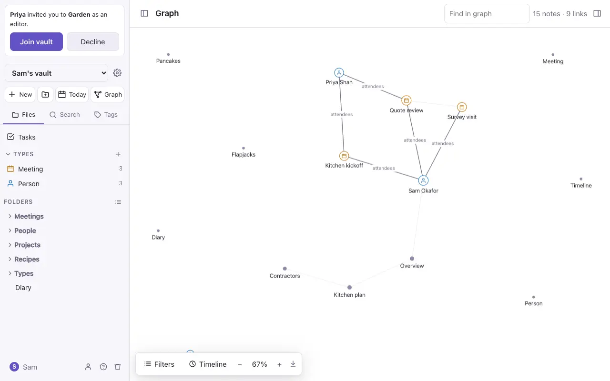
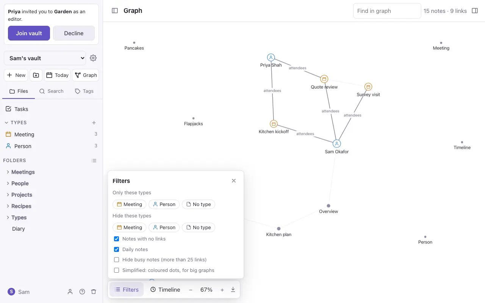
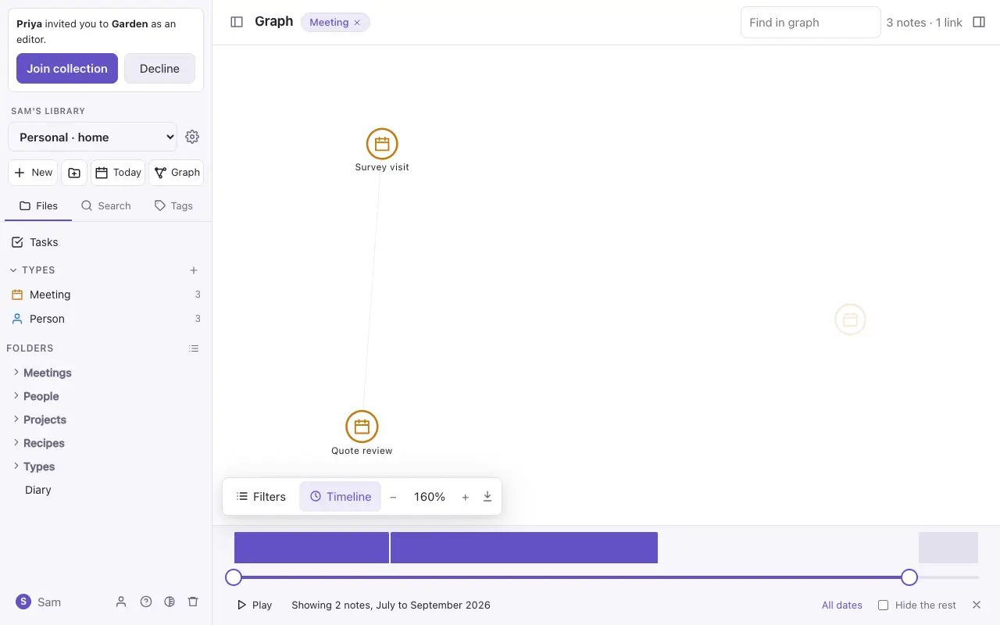
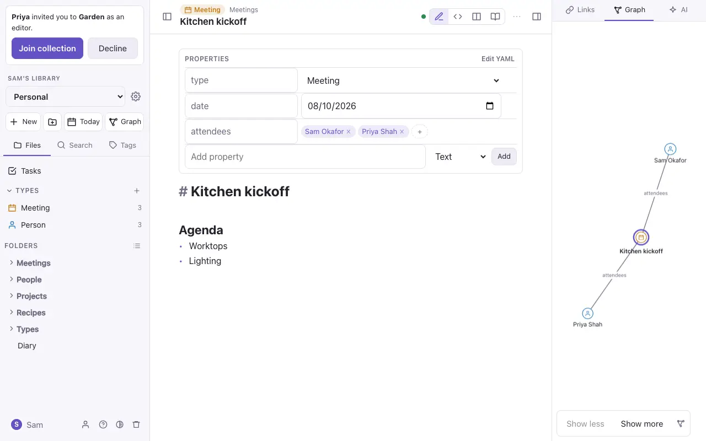

# The graph

**Graph** (at the top of the file panel) draws your notes and the links between them:

- A note of a [type](types.md) shows its type's icon in its colour. Other notes are dots, bigger when they have more links.
- A link made by a property, such as `attendees: [[Sam]]`, is labelled with the property's name, so you can see why two notes are joined. Links in the text are fainter, with no label.
- Click a note to open it. Drag to move around, drag a note to move it, and pinch or scroll to zoom. Point at a note to light up its links.

The bar at the bottom has:

- **Filters**: show only some types, or hide some; leave out notes with no links or daily notes; hide busy notes (more than 25 links); or a simplified drawing of coloured dots for big vaults. A number on the button shows how many filters are on. They're kept on this device.
- **− 100% +** to zoom. Press the percentage to fit everything in.
- **Save as a picture**, which downloads the graph as a PNG.
- **Timeline**, to see the notes of a period (below).
- **Show more / Show less** when the graph is around one note.

Find in graph (at the top) moves to a note by its name.

## The timeline

**Timeline** opens a strip under the graph. Its bars show how many notes there are in each month, and two handles set a range of days: notes outside it fade (or, with **Hide the rest**, disappear), and a link shows only when both its notes are in range. Nothing moves when the range changes, so you can see where each period sits.

- **Play** grows the graph from the first month to the last. Pressing on the graph pauses it.
- Click a month's bar to see just that month; **All dates** goes back to everything.
- With the keyboard, the arrow keys move a handle a day, and Page Up and Page Down a month.
- The range is in the page's address, so a link to it opens the same period.

A note's date is the first of these it has:

1. a daily note's day;
2. a `date:`, `created:` or `day:` property;
3. its [type](types.md)'s date: the property the type names with `timeline: met` in its own note, or else its first date property (except a birthday);
4. the day it was made in Commonplace. Imported notes were all made on the day of the import, so give them a `date:` to place them.

## Around one note

The side panel's **Graph** tab shows the open note in the middle with the notes it links to and from. **Show more** steps out to their links too, a step at a time, and **Show less** steps back. It follows you from note to note, on the iPhone too. The graph button in its bar opens the full graph around the note; so does `⌘K` → **This note in the graph**.

## Just part of the vault

Open the graph for only some notes:

- a type: **Graph** at the top of its page;
- a folder: **Show in graph** in its `⋯` menu;
- a tag: the graph button beside it in the **Tags** tab;
- a saved search: the graph button beside it.

The title shows what you're looking at. Press it to go back to the whole vault.
