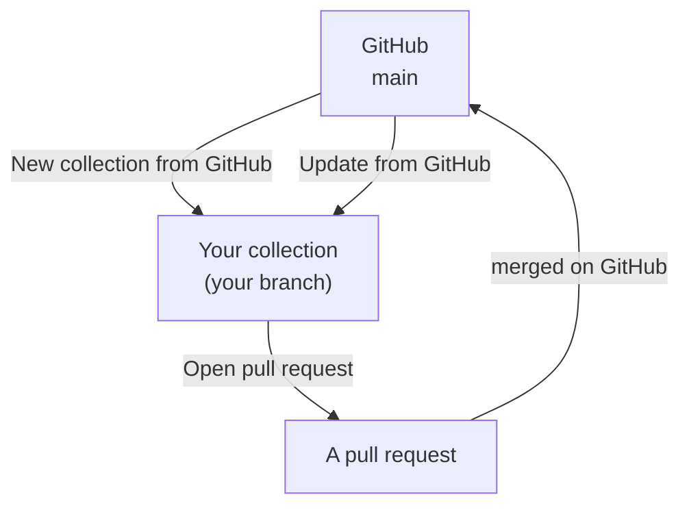
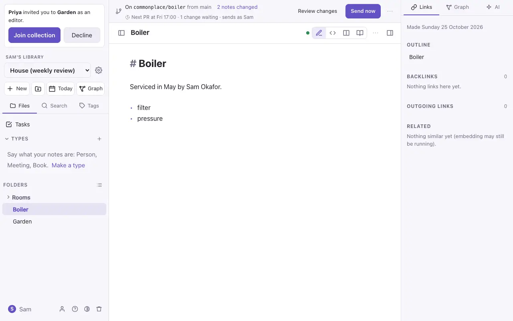
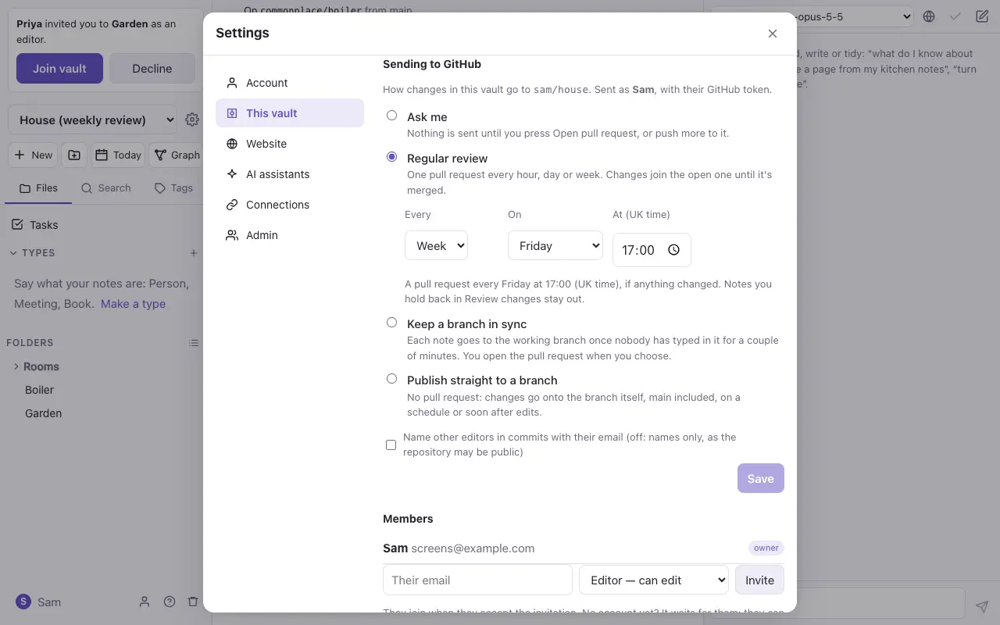

# Import, export and GitHub

## Import

Settings → **This collection** → **Import markdown**. Pick a `.zip` of a collection, a folder, or some `.md` files. Folders, pictures and links come in as they are. App-settings folders (names starting with `.`) are skipped.

If a note already exists you choose what happens: **skip** it, **overwrite** it (the old version stays in its history), or **keep both**.

## Export

- **One note**: **Download .md** in the note's ⋯ menu.
- **The whole collection**: **Export collection as .zip** in `⌘K`, or in Settings → This collection. The zip is a plain folder of Markdown files and attachments that other Markdown editors open as they are.

## Backups

The server can make a backup of every collection each day; an admin sets this up. See the project's README for how.

## GitHub collections

A GitHub collection is a repository of Markdown (or one folder of it, such as `docs/`) opened as a collection, using your own GitHub token.

1. Settings → **Connections** → **GitHub**: add a fine-grained token for the repository.
2. **New collection from GitHub…** in `⌘K`: pick the repository, branch and folder.
3. Edit as usual. A bar at the top says which branch you're on and how many notes have changed.
   On an iPhone the bar is at the top of the Files panel, so the note keeps the whole screen; a
   dot on the Files button means there are changes not on GitHub yet (orange: something to settle,
   or sending is paused).

- **Review changes** lists each changed note with its differences from GitHub, and a **Revert** for each.
- **Open pull request** sends your changes to GitHub as a pull request. Later edits are added to it with **Push changes to the pull request**.
- **Update from GitHub** brings in newer work. Notes changed on both sides are merged line by line, and a real clash waits for you to pick a side.
- **Cancel the branch** puts every note back as it is on GitHub.

Unless an owner chooses to publish straight to it (below), nothing reaches `main` without a pull request. Files that aren't notes or pictures (code, settings) are never touched.

### Sending changes on their own

An owner chooses how a GitHub collection's changes go to GitHub, in Settings → **This collection** → **Sending to GitHub** (or `⌘K` → **How changes go to GitHub…**):

- **Ask me** (the default): nothing is sent until you press **Open pull request**.
- **Regular review:** one pull request every hour, day or week, at a time you choose (UK time). If nothing changed, nothing is sent. Changes join the open pull request until it's merged; after that, the next one opens a new pull request.
- **Keep a branch in sync:** each note goes to the working branch once nobody has typed in it for a couple of minutes. You open the pull request when you choose.
- **Publish straight to a branch:** no pull request. Changes go onto the branch itself (`main`, or another you name), on a schedule or soon after edits. A push to `main` often builds or deploys a site, so the schedule is the safer choice. Deleted notes wait until someone presses **Send now**.

Changes are sent with the GitHub token of the owner who chose, and the bar says so.

- **Send now** sends straight away, in any of these ways.
- **Hold back** a note in Review changes to keep it out until you **Release** it.
- **Pause automatic pushes** is in the bar's `⋯` menu. Use it for a big reorganisation.
- Before every send, newer work on GitHub is merged in first. If a note clashes, sending pauses until you pick a side in Review changes, then carries on by itself.
- If the sender disconnects GitHub or stops being an editor, or GitHub refuses a push (for example, a protected branch), sending pauses and the bar says why.
- Commits name the other people who edited the notes. Their emails are left out unless the owner turns that on, since the repository may be public.

