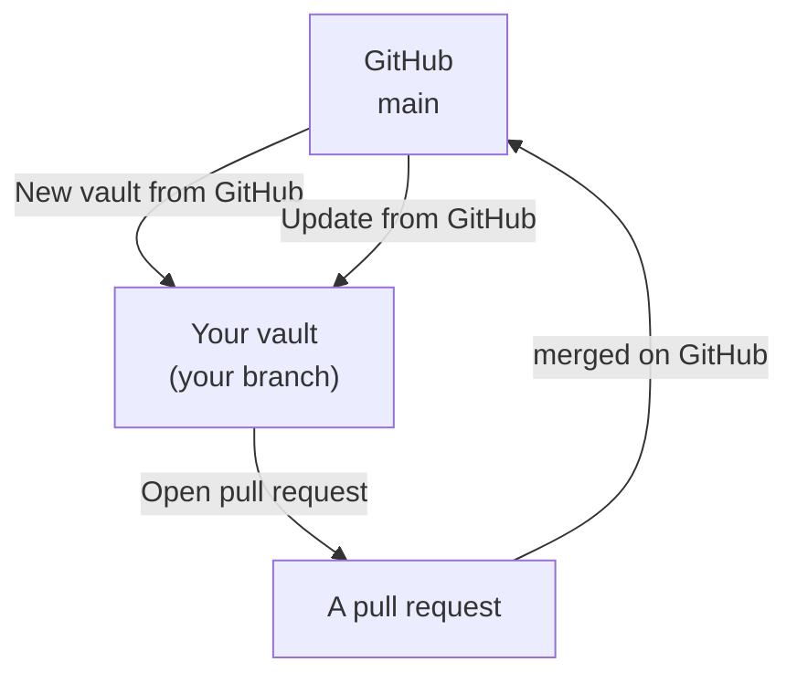
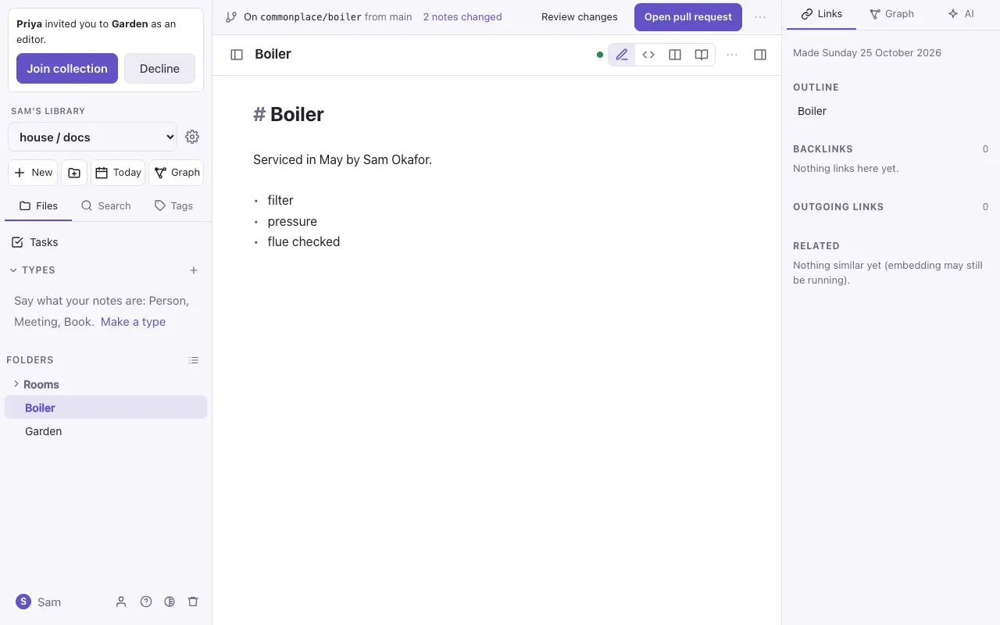
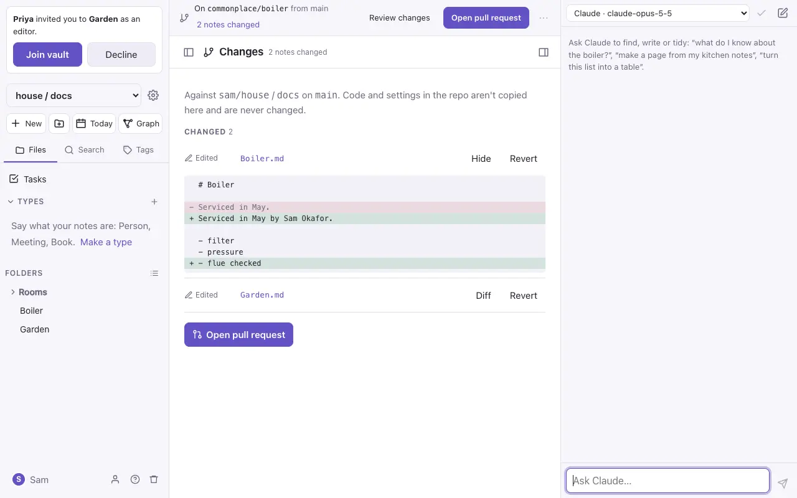
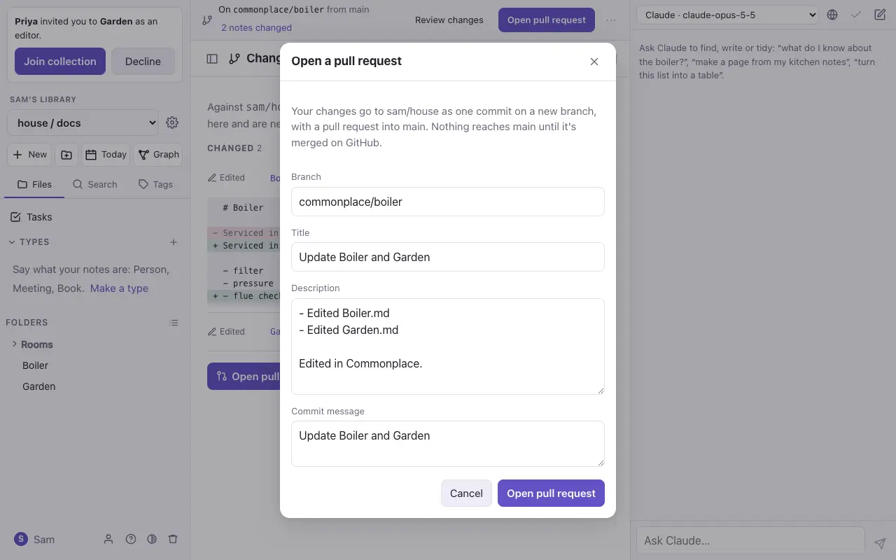

# Import, export and GitHub

## Import

Settings → **This vault** → **Import markdown**. Pick a `.zip` of a vault, a folder, or some `.md` files. Folders, pictures and links come in as they are. App-settings folders (names starting with `.`) are skipped.

If a note already exists you choose what happens: **skip** it, **overwrite** it (the old version stays in its history), or **keep both**.

## Export

- **One note**: **Download .md** in the note's ⋯ menu.
- **The whole vault**: **Export vault as .zip** in `⌘K`, or in Settings → This vault. The zip is a plain folder of Markdown files and attachments that other Markdown editors open as they are.

## Backups

The server can make a backup of every vault each day; an admin sets this up. See the project's README for how.

## GitHub vaults

A GitHub vault is a repository of Markdown (or one folder of it, such as `docs/`) opened as a vault, using your own GitHub token.

1. Settings → **Connections** → **GitHub**: add a fine-grained token for the repository.
2. **New vault from GitHub…** in `⌘K`: pick the repository, branch and folder.
3. Edit as usual. A bar at the top says which branch you're on and how many notes have changed.

- **Review changes** lists each changed note with its differences from GitHub, and a **Revert** for each.
- **Open pull request** sends your changes to GitHub as a pull request. Later edits are added to it with **Push changes to the pull request**.
- **Update from GitHub** brings in newer work. Notes changed on both sides are merged line by line, and a real clash waits for you to pick a side.
- **Cancel the branch** puts every note back as it is on GitHub.

Nothing reaches `main` without a pull request, and files that aren't notes or pictures (code, settings) are never touched.

