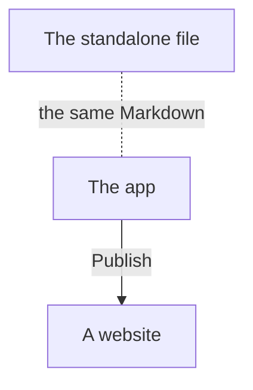

# Help

Commonplace is a Markdown notebook. Every note is a plain `.md` file, so your notes always open in other Markdown editors, and nothing is locked in.

## Three ways to use it

- **The app** is the full version: collections you can share, several people editing at once, search, types, tasks, AI assistants and websites. Start with [Getting started](getting-started.md).
- **The standalone file** (`commonplace.html`) is the editor on its own. It opens a folder of Markdown files on your computer, with no account and no server. See [The standalone file](standalone.md).
- **A website** is a copy of a collection, or of some of its folders, published as pages anyone with the link can read. See [Publish a website](website.md).

## Topics

| Topic | What it covers |
| --- | --- |
| [Getting started](getting-started.md) | Signing in, the screen, your first note |
| [Writing notes](writing.md) | Live Preview, formatting, the `/` menu, tables, pictures |
| [Links and embeds](links.md) | `[[Links]]`, backlinks, notes inside notes |
| [The graph](graph.md) | Notes and links by type, around one note, filters and parts of the collection |
| [Organising notes](organising.md) | Folders, tags, bookmarks, Trash and version history |
| [Properties and types](types.md) | Properties, and types such as Person, Meeting and Book |
| [Tasks and daily notes](tasks.md) | Every to-do in one place, and a note for each day |
| [Finding things](search.md) | Search, the quick switcher and the command list |
| [Queries and diagrams](queries.md) | Dataview queries and Mermaid diagrams |
| [Sharing and live editing](sharing.md) | Members, roles and editing together |
| [AI assistants](ai.md) | Bring your own AI, and connecting Claude |
| [Publish a website](website.md) | Turning a collection into a website |
| [Import, export and GitHub](import-export.md) | Moving notes in and out, backups, GitHub collections |
| [On the iPhone](iphone.md) | The home-screen app, offline use and sharing from other apps |
| [The standalone file](standalone.md) | Commonplace in one file, with no server |
| [Keyboard shortcuts](shortcuts.md) | Every shortcut |
| [Settings](settings.md) | What each section of Settings does |

> [!tip] Try it with the demo collections
> The demo collections *The Allotment Notebook* and *Harbour Studio* show most of what's here. Import one into a new collection (Settings → This collection → Import markdown) and look around.
