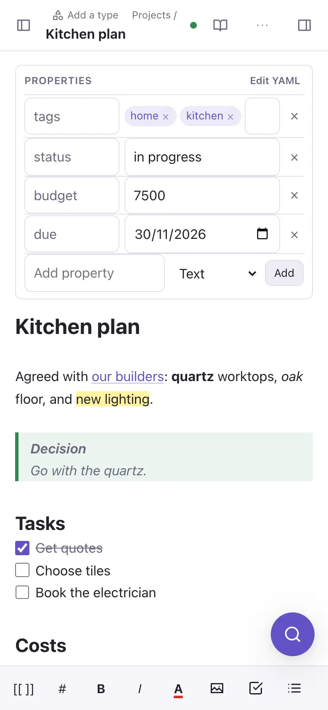
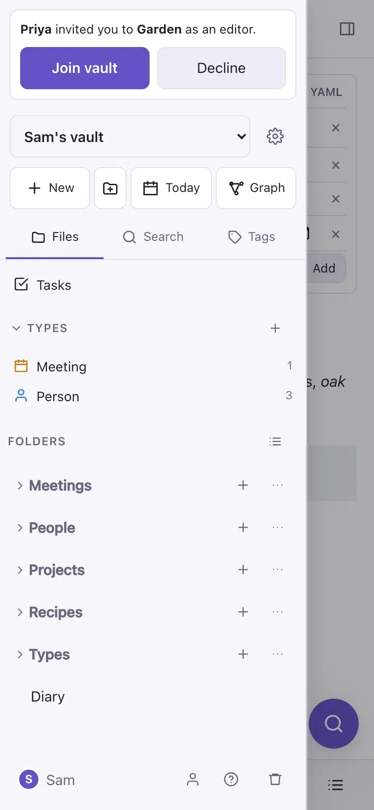
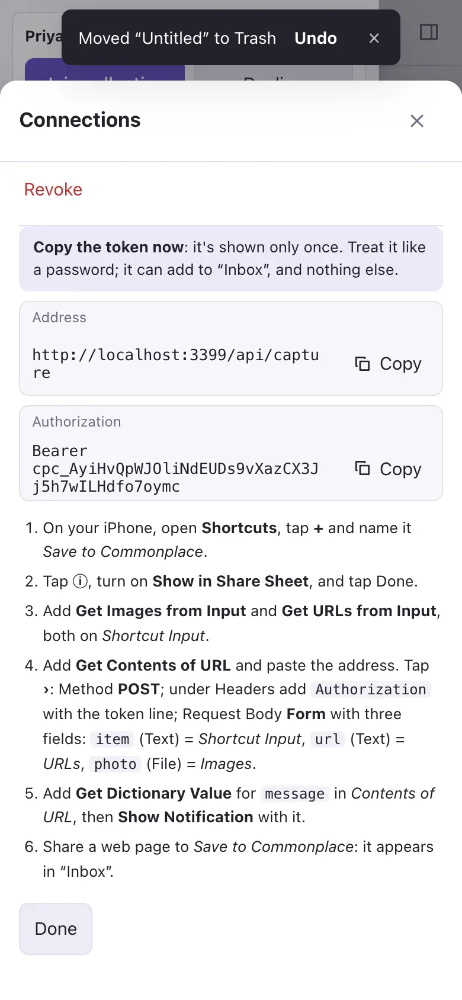

# On the iPhone

## Add it to the home screen

Open Commonplace in Safari, then **Share** → **Add to Home Screen**. It opens full screen, like an app.

## The phone layout

The note fills the screen. The file panel slides in from the left (the button at the top left) and the side panel from the right. Above the keyboard, a bar has formatting buttons, the `/` menu and the picture button, which picks from Photos or takes a photo.

Press and hold a note or folder in the file panel to drag it. The view switch at the top of a note goes between editing and reading.

## Offline

Every note you've opened is kept on the phone. With no signal, the app still opens, you can read and edit those notes, and your changes merge with everyone else's when you're back online. Signing out removes them from the phone.

## Share from other apps

Settings → **Connections** → **Share from iPhone** sets up an Apple Shortcut, so **Save to Commonplace** appears in every app's share sheet. Links, text and photos you share land as to-dos in an inbox note. A shared web link can also become a **Weblink** note, with the page's title, summary and picture.

