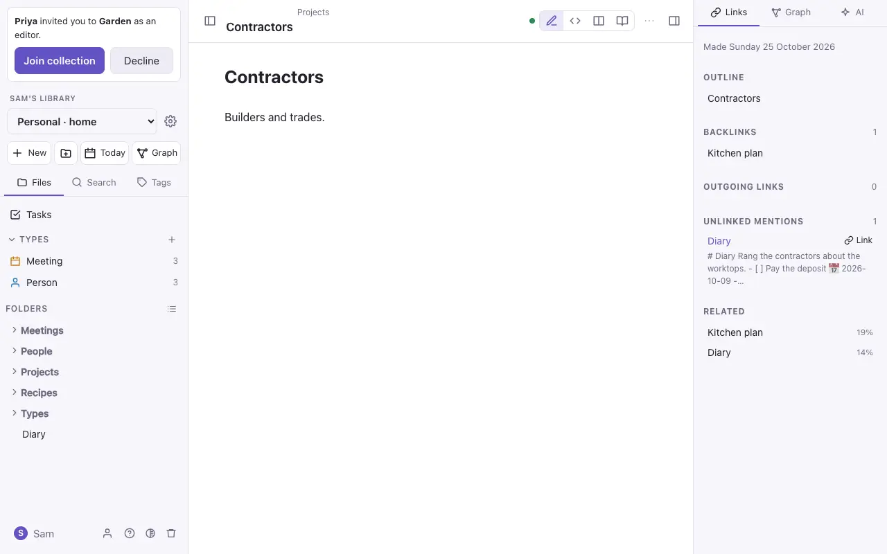
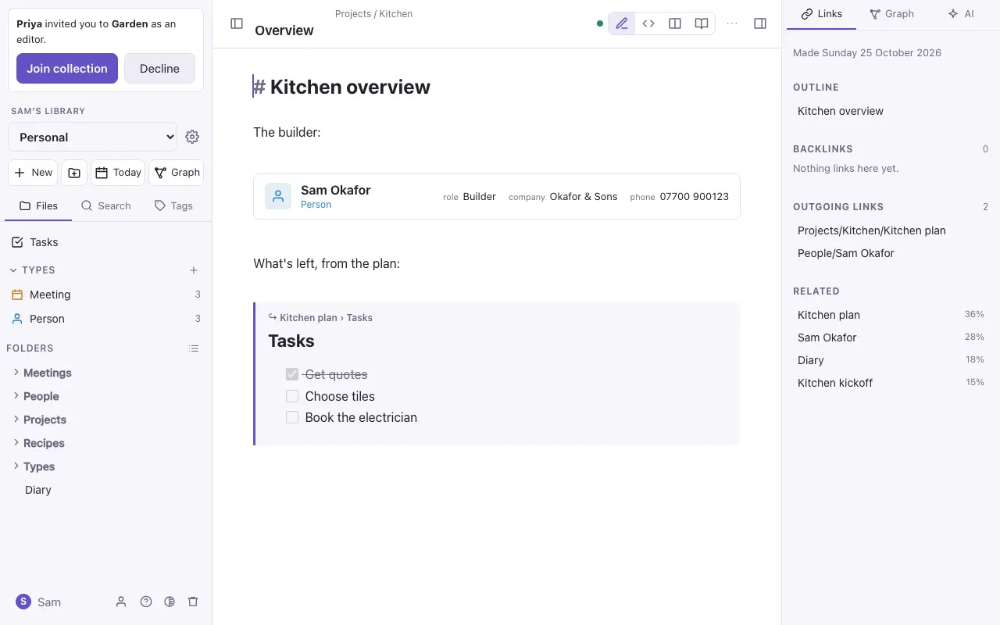

# Links and embeds

Links turn a pile of notes into a web of ideas. Commonplace keeps track of every link in both directions.

## Linking to a note

Type `[[` and start typing a note's name, then pick it from the list.

| Write | It links to |
| --- | --- |
| `[[Tomatoes]]` | The note *Tomatoes*, wherever it is |
| `[[Tomatoes\|our tomatoes]]` | The same note, shown as "our tomatoes" |
| `[[Tomatoes#Blight]]` | The *Blight* heading in that note |
| `[[Garden/Plants/Tomatoes]]` | A note by its full path, when two share a name |

A link can also use one of the note's `aliases` (a property listing other names for it).

`⌘`-click a link to follow it, or put the cursor in it and tap **Open ↗**. In Reading view, click it.

A link to a note that doesn't exist yet is shown faded. Follow it to make the note, and you can choose whether it's a plain note or one of your [types](types.md). The link works as soon as the note exists.

Renaming a note updates every link to it. (In the standalone file, links aren't updated.)

## Backlinks, mentions and related notes

The **Links** tab of the side panel shows, for the open note:

- **Outline**: its headings. Click one to jump there.
- **Backlinks**: the notes that link here.
- **Outgoing links**: the notes this one links to, including ones not made yet.
- **Mentions**: notes that use this note's name without linking to it. **Link** turns a mention into a link.
- **Related**: notes closest in meaning, found by search. (App only.)

## Notes inside notes

Put `!` before a link to show that note, or a part of it, in place:

- `![[Kitchen plan]]` shows the whole note.
- `![[Kitchen plan#Tasks]]` shows only the *Tasks* section.
- `![[photo.png]]` shows a picture, and `![[talk.mp3]]` a player.

Embeds can go three deep, and a note that embeds itself is cut off rather than looping.

A link to a typed note on a line of its own shows as a **card**, with the note's type and key properties.

## The graph

The graph draws your notes and the links between them, with each type's icon and the property behind each link. See [The graph](graph.md). (App only.)
