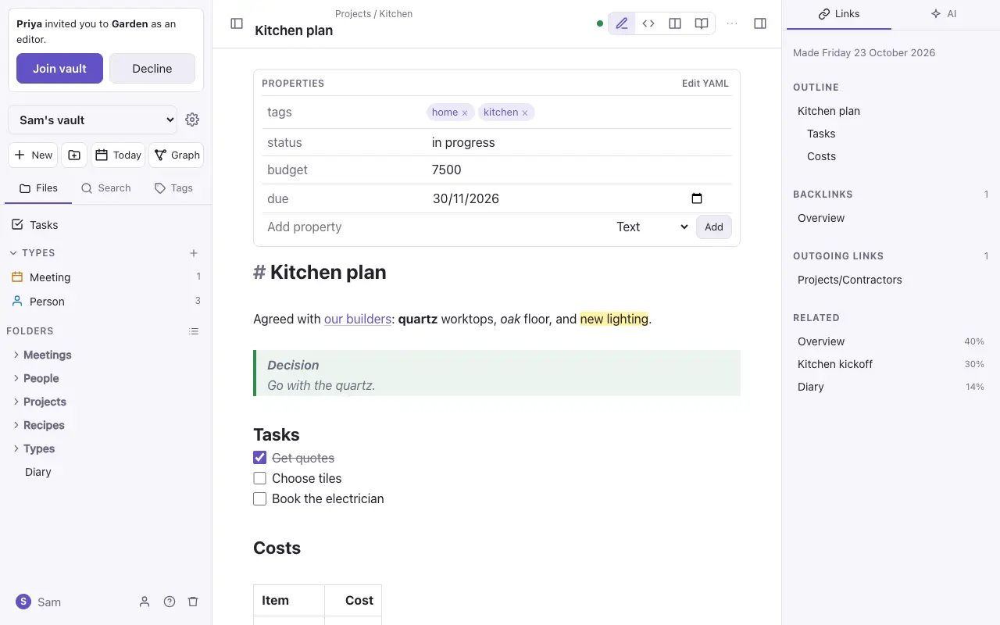
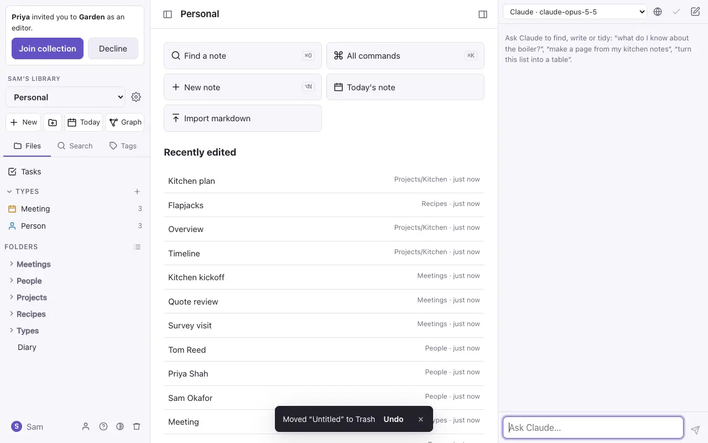
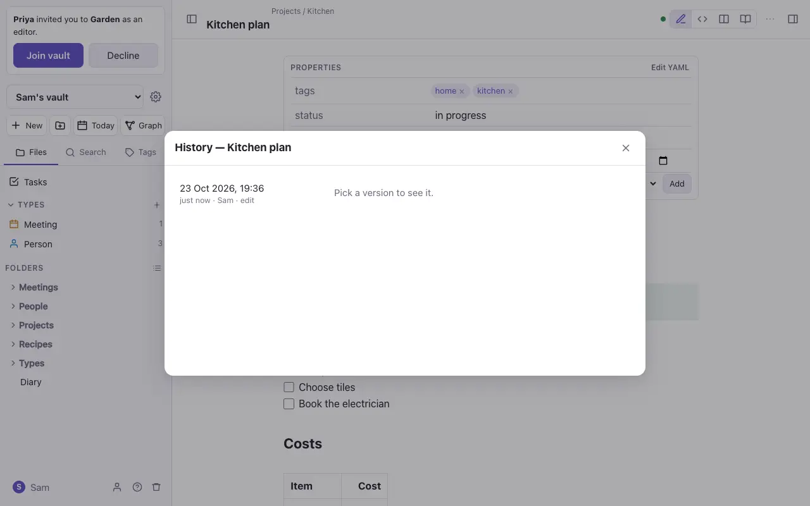

# Organising notes

Use folders when a note belongs in one place, tags when it belongs to several groups, and links and [types](types.md) for everything in between.

## Folders

- **Make a folder** with the folder button at the top of the file panel. Folders can hold folders.
- **Move notes and folders** by dragging them onto a folder, or onto empty space to move them to the top. On a phone, press and hold, then drag. **Move to…** in a note's ⋯ menu does the same.
- **Rename or move a folder** and everything inside goes with it. An empty folder can be deleted.
- **Sort** the notes by name, last changed first or newest first, with the list button beside *Folders*.

## Another collection

**Copy to another collection…** and **Move to another collection…** are in a note's ⋯ menu and in a folder's menu, when you have another collection you can add notes to. Pick the collection, then the folder there. A GitHub collection works like any other: what arrives shows as changes to send.

- **What comes along:** pictures and files the notes embed, and everything inside a folder. If a note has a [type](types.md) the other collection hasn't got, the type comes too.
- **A name already taken** keeps both: the new one becomes "Plan 1". A different picture with the same name is renamed, and the note points at the new name.
- **A move** takes each note's version history with it, and puts the original in Trash here, where it can be restored for 30 days. Pictures and files are copied, never removed. Links to a moved note from notes that stay behind no longer find it.
- **Undo** in the message afterwards takes the copies away (to Trash in the other collection) and, after a move, brings the originals back.
- You need to be able to edit the other collection. To move, you need to be able to edit this one too; a viewer can still copy.

The [AI assistant](ai.md) can do this when you ask it.

## Tags

Write `#tag` anywhere in a note, or list tags in its `tags` property. Tags can nest: `#garden/planning` is inside `#garden`. The **Tags** tab lists every tag with a count; click one to search for it.

## Bookmarks

**Bookmark** in a note's ⋯ menu pins it to the top of your file panel. Bookmarks are yours: other members don't see them.

## Trash and Undo

Deleting is never final straight away.

- **Move to Trash** takes a note out of the collection and shows an **Undo** button for a few seconds.
- **Trash** (the bin at the bottom of the file panel) keeps deleted notes, with their history, for 30 days. Restore one from there.

## Version history

**Version history** in a note's ⋯ menu lists earlier versions: one is kept every ten minutes while someone is editing, and before every import or restore. Pick one to see what changed, and restore it if you want it back. Each note keeps its newest 100 versions. (App only.)

> [!note] In the standalone file
> Folders, tags, rename, move and delete all work, but there's no Trash or version history: changes are written straight to the files.
