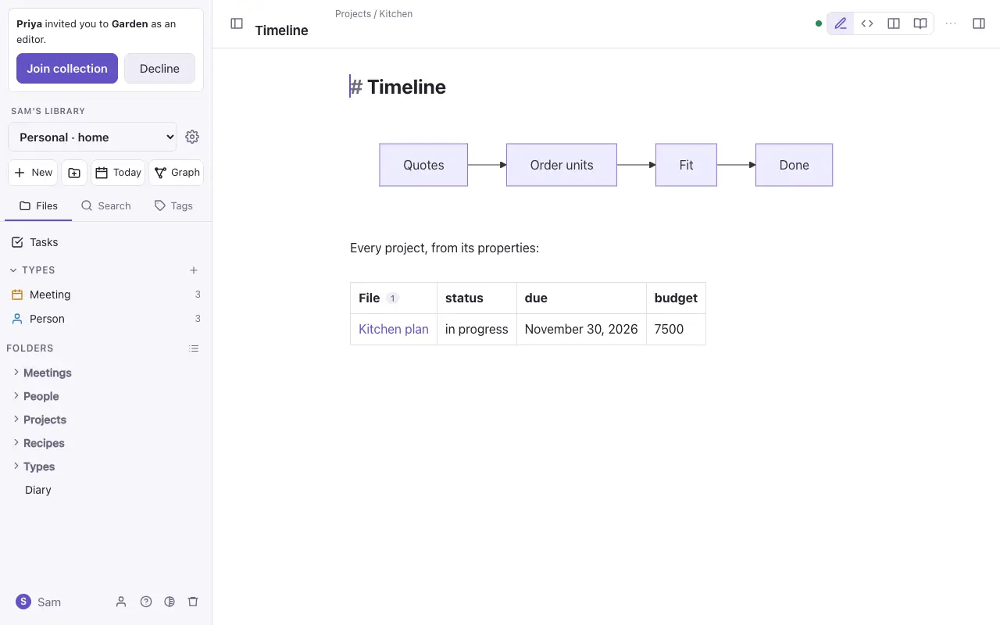
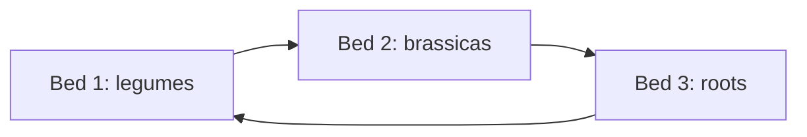

# Queries and diagrams



## Dataview queries

A `dataview` code block is a query that lists notes from their properties, tags, links and tasks. Its result stays up to date as the vault changes. Commonplace reads the same query language as the Dataview plugin for other Markdown editors.

````
```dataview
TABLE author AS "Author", status, rating
FROM "Reading"
WHERE type = "Book"
SORT rating DESC
```
````

| Part | What it does |
| --- | --- |
| `TABLE a, b` | A table with a column for each property. Also `LIST` and `TASK` (every matching task, which you can tick), and `CALENDAR date` (a month with a dot on each day). |
| `FROM "Folder"` | Only notes in that folder. Also `FROM #tag` and `FROM [[Note]]` (notes linking to it). |
| `WHERE` | Only notes where something is true, such as `WHERE status = "Active"` or `WHERE !completed`. |
| `SORT x DESC` | The order. |
| `GROUP BY x`, `FLATTEN x`, `LIMIT 10`, `WITHOUT ID` | Grouping, splitting lists, limiting, and leaving out the file column. |

Inline queries show one value in the text: `` `= this.due` ``. A count works too: `` `$= dv.pages('"Garden/Plants"').length` ``.

### dataviewjs

A `dataviewjs` block runs JavaScript with Dataview's API (`dv.pages`, `dv.table`, `dv.list` and the rest). It runs in a sealed box: it can read the vault's notes and draw in its own space, but it can't reach the network, the app or your account. A script that never stops is stopped after five seconds.

## Mermaid diagrams

A `mermaid` code block draws a diagram: flowcharts, sequence diagrams, Gantt charts, pie charts, mind maps and more.

````

````

Click a diagram in Live Preview to edit its text. A node with `class A internal-link` opens the note it names.

> [!note] On a published website
> Pages run no scripts, so a diagram shows as its text, and queries show the results worked out when you pressed Publish, from the published notes only. See [Publish a website](website.md).
