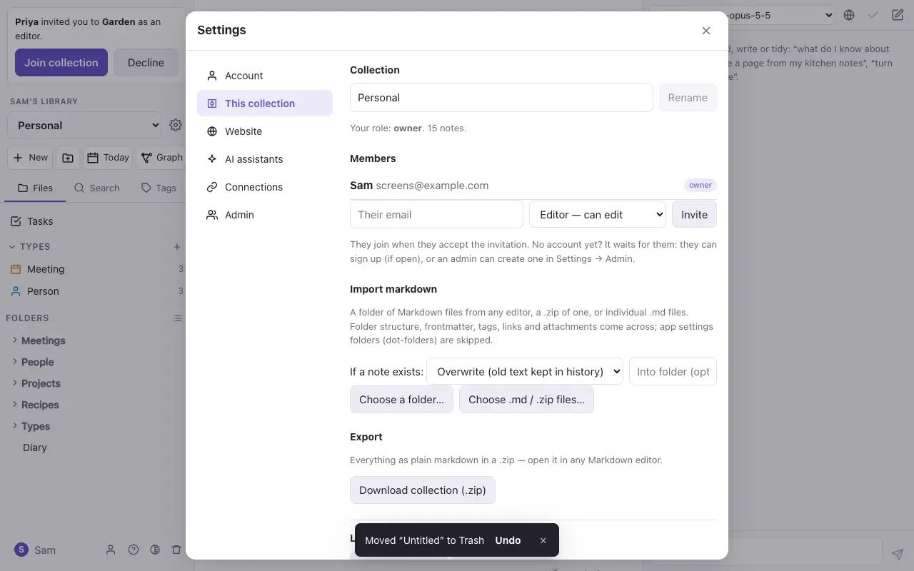

# Settings

Every setting is in one place. Open Settings from your name at the bottom of the file panel, the gear beside the collection menu, or `⌘K` (type the setting's name, such as "members" or "website"). On a laptop the sections are listed beside the open one; on a phone the list comes first.

| Section | What's there |
| --- | --- |
| **Account** | Your name, the theme (Auto, Light or Dark), your password, and Sign out. |
| **This collection** | The collection's name, its **members** and invitations, **import** and **export**, and leaving or deleting the collection. See [Sharing](sharing.md) and [Import and export](import-export.md). |
| **Website** | Publishing the collection as a website: what's included, features, the preview, and taking it down. Owners only. See [Publish a website](website.md). |
| **AI assistants** | Your assistants, their keys, models and daily limits. See [AI assistants](ai.md). |
| **Connections** | **Connect Claude** (an MCP token), **GitHub** (your token for GitHub collections) and **Share from iPhone** (a token for the Apple Shortcut). Each token can be revoked. |
| **Admin** | For admins: the library's name, making accounts, and how full the database is. |

## Storage

The database has a fixed size. When it's 80% full, admins are told. At 90%, new notes, files and imports are refused with a message saying why, but typing in notes you have open carries on. A single note can be up to 5 MB.
