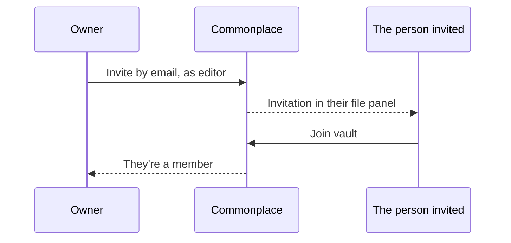

# Sharing and live editing

## Members and roles

Each vault has its own members, and each member has a role:

| Role | Can |
| --- | --- |
| **Owner** | Everything an editor can, plus invite and remove people, change roles, publish the vault as a website, rename it and delete it. |
| **Editor** | Read, write, make, move and delete notes and folders. |
| **Viewer** | Read only, everywhere. |

## Inviting someone

1. Settings → **This vault** → **Members**.
2. Enter their email and pick a role.
3. They see the invitation at the top of their file panel, with **Join vault** and **Decline**. If they don't have an account yet, it waits for them.

Nobody can see the vault until they accept. An owner can cancel an invitation, or remove a member (with Undo), and anyone can leave a vault they've joined with **Leave vault**.

## Editing together

Several people can be in one note at once. You see each other's cursors and selections, with names, and the people in the note at the top. Changes merge letter by letter, so nobody's typing is lost, and **Undo** undoes only your own changes.

If you lose your connection, keep typing: the note merges with everyone else's changes when you're back online.
