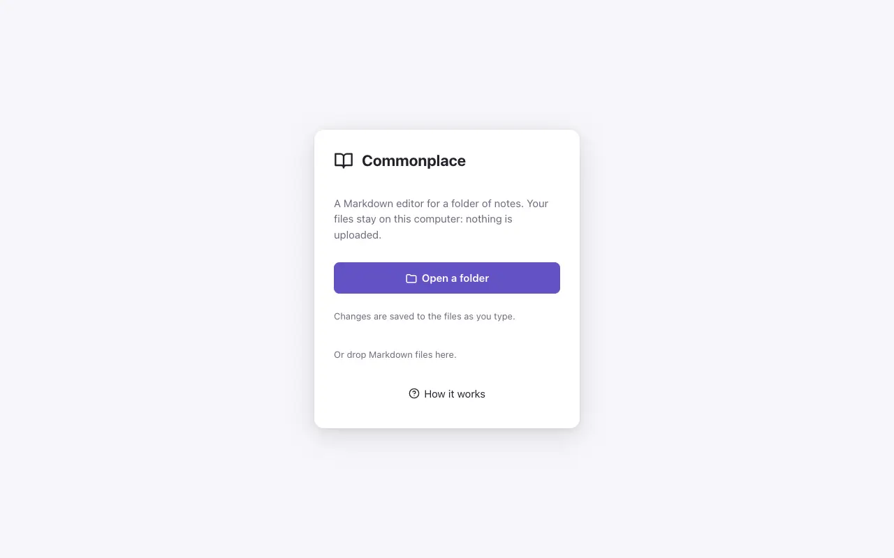
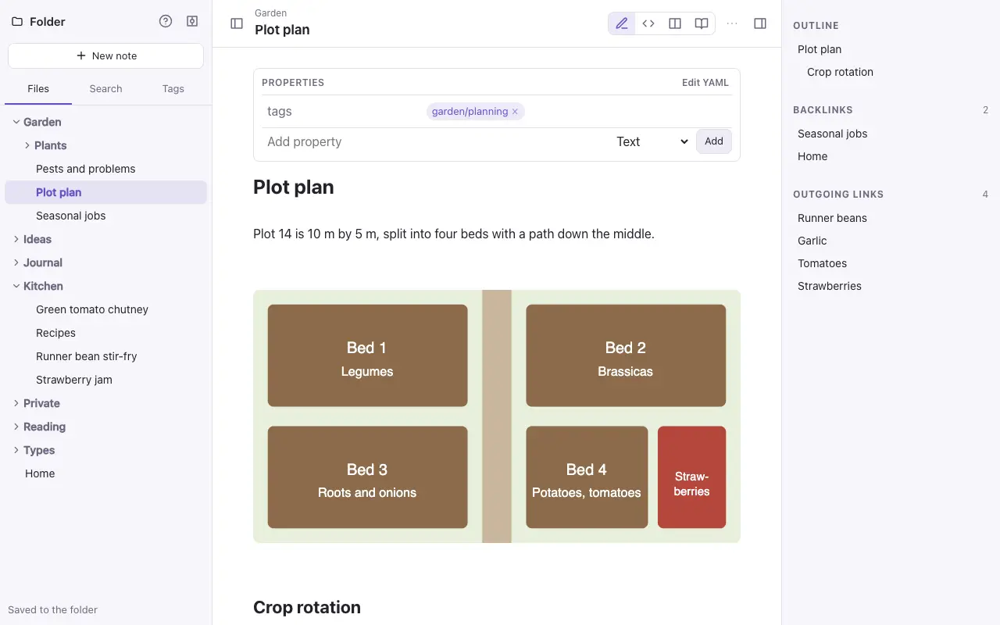
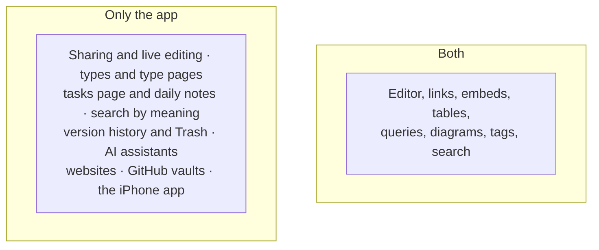

# The standalone file

`commonplace.html` is Commonplace's editor in one file. Open it in a browser, choose a folder of Markdown files, and edit. There's no account, no server and no upload: your notes stay on your computer.

Download it from the project's releases on GitHub.

## Which browser

| Browser | How it saves |
| --- | --- |
| **Chrome** and **Edge** | They open the real folder and save each change to its file half a second after you stop typing. **Reopen** opens the last folder in one click. |
| **Safari** and **Firefox** | They can't write to a folder, so the folder (or some files) is read into the tab. **Download changes** saves the changed notes as a zip to unzip over the folder. Closing the tab with changes not downloaded asks first. |

## What it has

- The same editor as the app: Live Preview, Source, side by side and Reading; links and `[[` completion, embeds, callouts, tables, tasks, properties and tags; [Mermaid diagrams and Dataview queries](queries.md).
- A file panel with folders, search (words and `#tags`) and a tag list.
- Backlinks, outgoing links and the outline in the side panel.
- `⌘O` to open a note by name. Following a link to a note that doesn't exist makes it, beside the note it was in.
- Pasted or dropped pictures are saved in `attachments/`.
- Rename, move and delete notes.

## What only the app has

Renaming a note in the standalone file doesn't update links to it, and hidden folders (such as `.git`) and `node_modules` are skipped.

> [!tip]
> The standalone file and the app read the same Markdown. A folder you edit in one opens in the other: export a vault as a zip and open it in the standalone file, or import a folder you've been editing into a vault.
