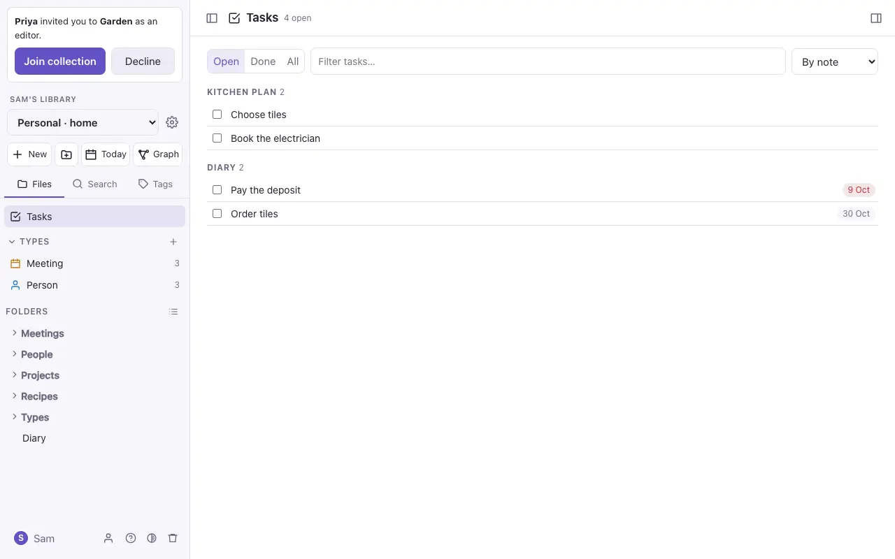

# Tasks and daily notes

## Tasks

Any line like `- [ ] Order seeds` is a task, in any note. Tick its box in Live Preview or Reading view to mark it done (`- [x]`).

Give a task a due date with a calendar emoji and a date: `- [ ] Pay the deposit 📅 2026-10-09`.

**Tasks** (at the top of the file panel) lists every task in the vault in one place:

- **Open** or **Done**.
- **By note**, or **By due date**: Overdue, Today, Later and No date.
- Tick a task there and it's ticked in its note.

## Daily notes

**Today** (at the top of the file panel) opens today's note, `Daily/2026-10-18.md`, and makes it if it isn't there yet. If there's a template called `Templates/Daily.md`, new daily notes start from it.

On a daily note the side panel shows a **calendar**: pick a day to open its note, and see what was made and changed in the vault that day.

> [!tip]
> A `TASK` query in a daily note can gather the tasks due that day; see [Queries and diagrams](queries.md).
