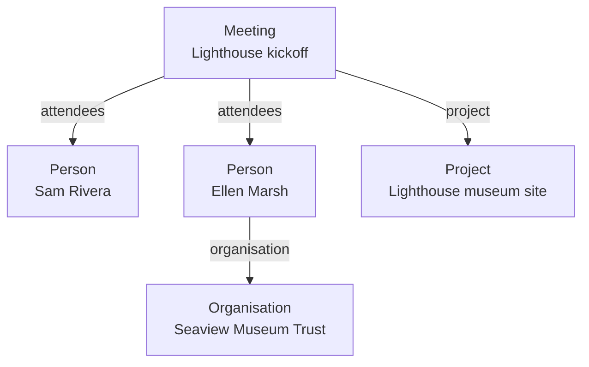
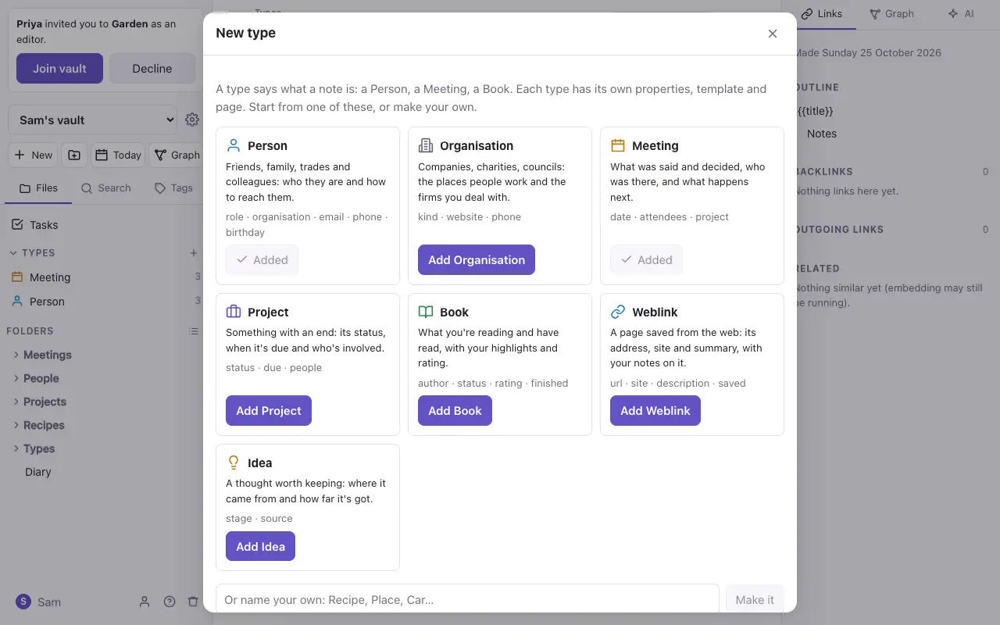
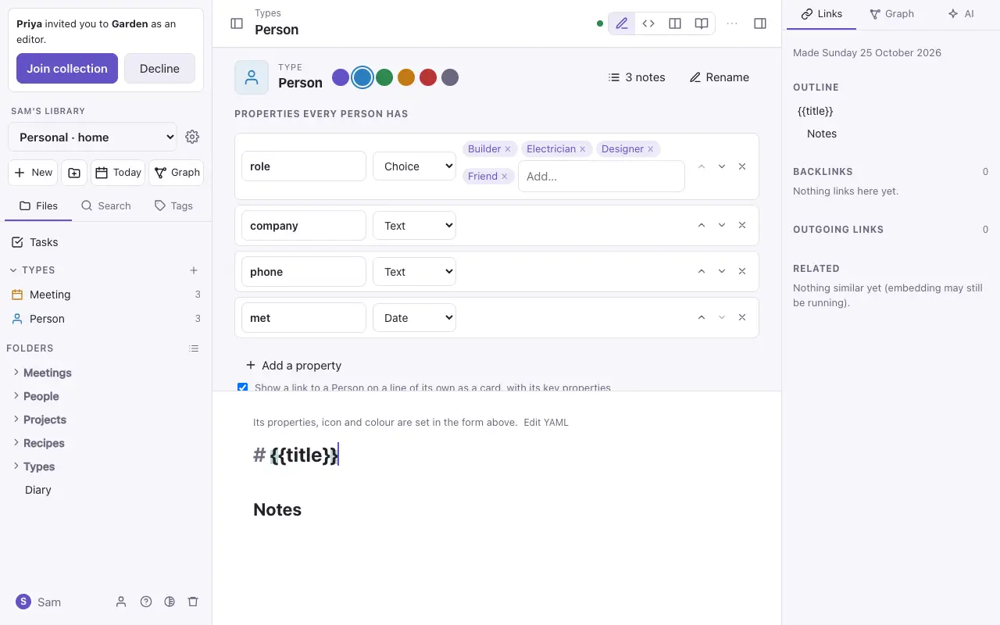
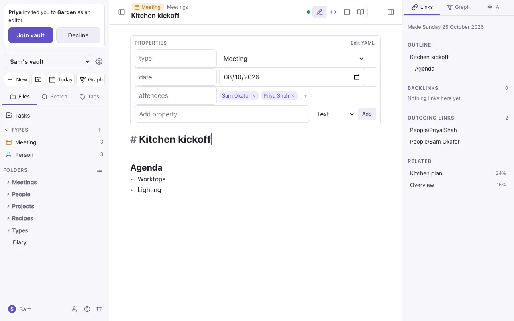
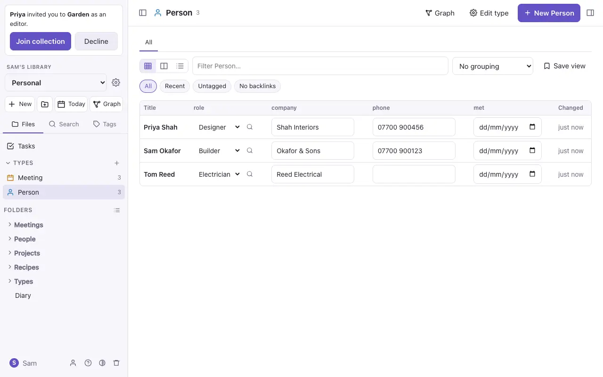

# Properties and types

## Properties

Properties are facts about a note, kept at the top of it in a block called *frontmatter*:

```yaml
---
status: Active
due: 2026-12-05
tags: [project, museum]
---
```

In Live Preview they show as a panel you edit in place: text, numbers, dates, tick boxes and lists. **Add property** adds one; **Edit YAML** shows the raw block. Properties can be read by [queries](queries.md) and shown on type pages (below).

You can also write a property inline, on a line of its own: `rain:: 12`.

## Types

A **type** says what a note *is*: a Person, a Meeting, a Book. Give a note `type: Person` and it gets that type's properties, icon and colour.



A type is itself a note, in the `Types` folder, such as `Types/Person.md`. Its properties list what every Person has, and its text is the template for a new Person.

- **New type** (the **+** beside *Types* in the file panel) starts from a ready-made type (Person, Organisation, Meeting, Project, Book, Weblink or Idea) or from nothing.
- **New note of a type…** (in `⌘K`) makes a note of a type, with its form ready to fill in.
- **Turn into a typed note…** makes a new typed note from the selected text, and links to it.



### Editing a type

Open a type's note to change its properties: text, number, date, tick box, list, a choice from a list, or a **relation** (a link to a note of another type, such as a Meeting's attendees). You can also set the icon and colour, and whether links to it show as cards. Renaming a property or the type changes it in every note.



### Relations

A relation is an ordinary link in a property: `attendees: ["[[Sam Rivera]]"]`. Both sides see it: Sam's note lists *As attendees: Lighthouse kickoff*.



## Type pages

Each type has a page (click it under *Types* in the file panel) listing its notes as a **table**, **cards** or a **list**. Filter, sort and group them, and edit cells in place. Save a view to keep it; views are saved in a `.base` file beside the type, which other editors read too.



> [!tip]
> Types are plain Markdown. Exported, a Person is a note with `type: Person` at the top, and the type is a note in `Types/`.
