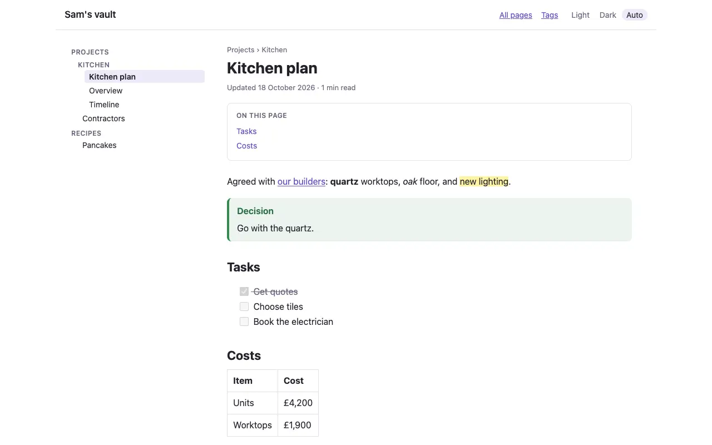
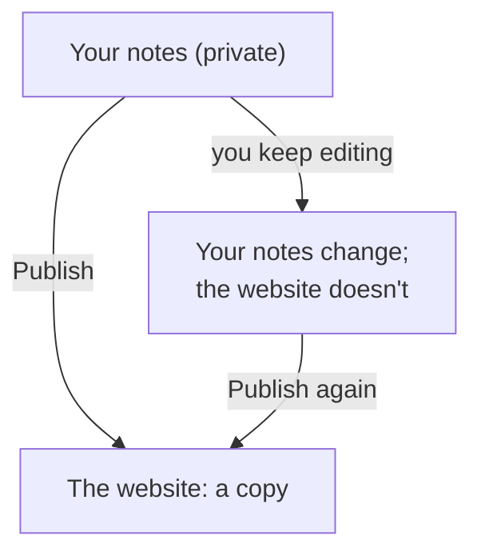
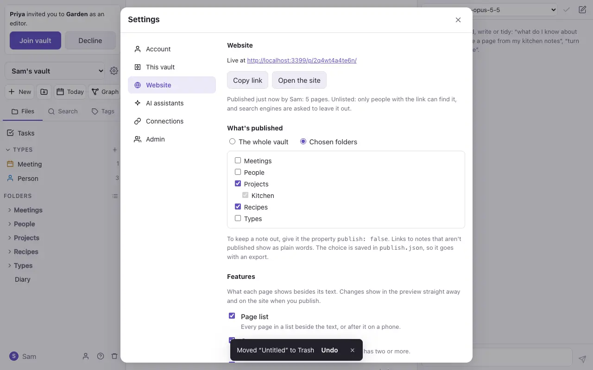
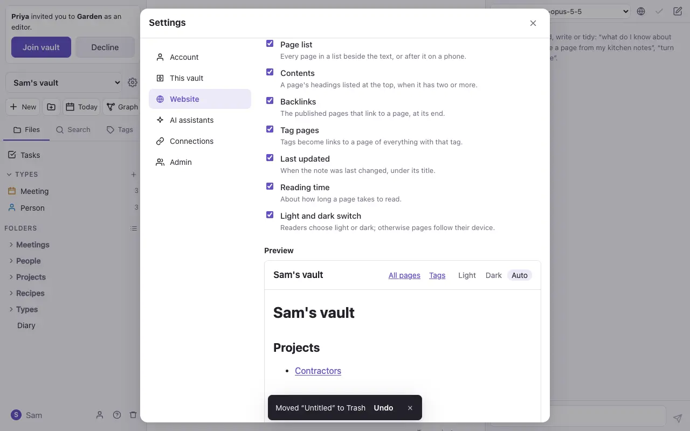

# Publish a website

An owner can publish a vault, or some of its folders, as a website: pages that anyone with the link can read, with no account.

## How it works

Publishing takes a **copy**. Your edits stay private until you publish again, and Settings lists what a new Publish would add, change or take down.

- A link to a note that isn't published shows as plain words, so its name doesn't leak.
- A note with `publish: false` in its properties is never published.
- Pictures and files are published only if a published page shows them.
- The site's address has a random part, and search engines are asked to leave it out. Anyone you give the link to can read it.

## Publishing

1. Settings → **Website**.
2. Choose what to publish: the whole vault, or some folders.
3. Switch on the features you want, and check the **preview**.
4. Press **Publish**. The site's link appears, with **Copy link**. After a change, the button says **Publish changes**.

## Features

| Feature | What it adds |
| --- | --- |
| Page list | Every page in its folders, beside the text (after it on a phone) |
| Contents | A list of the page's headings, when it has two or more |
| Backlinks | The published pages that link to this one |
| Tag pages | Tags become links to a page for each tag |
| Last updated | When the note last changed |
| Reading time | About how long the page takes to read |
| Light and dark switch | Light, Dark and Auto buttons in the header |

A top-level note called **Home**, **index** or **README** is the site's home page; otherwise the home page lists every page.

Your choices are kept in a file called `publish.json` at the top of the vault, so they go with an export or a GitHub repository.

## Taking it down

**Take the site down** removes it at once. **Put it back as it was** undoes that, and publishing again later uses the same address.

> [!note] What a published page can't do
> Pages run no scripts. Mermaid diagrams show as their text, and Dataview results are worked out when you press Publish, from the published notes only.
