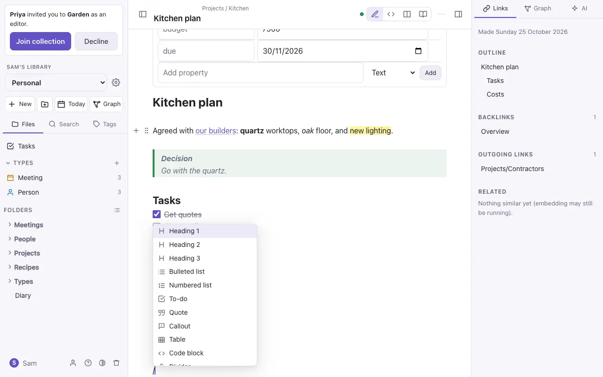
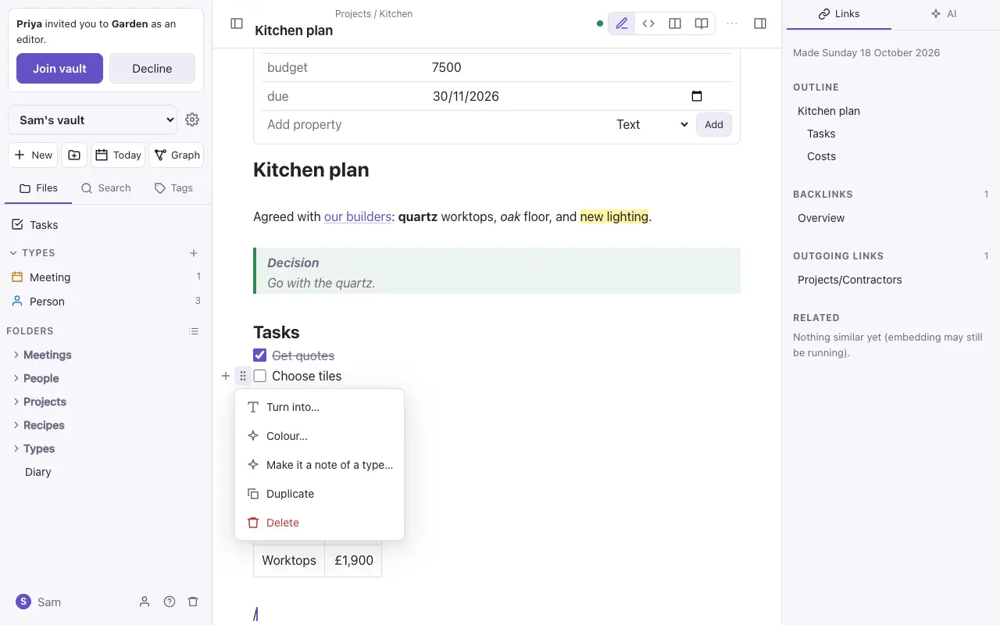
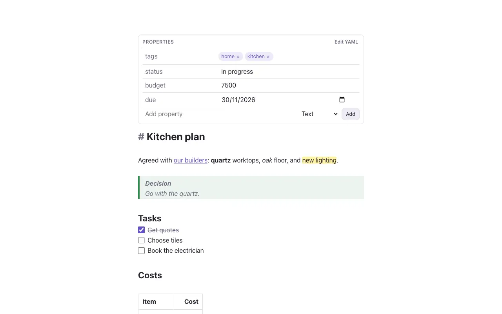
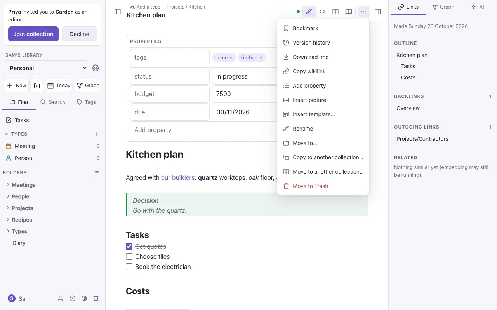

# Writing notes

Notes are Markdown. You don't need to know Markdown to start, because the `/` menu and the formatting bar write it for you, but everything you type is plain text you could edit anywhere.

## Four ways to see a note

The buttons at the top right of a note switch between them.

| View | What it shows |
| --- | --- |
| **Live Preview** (pencil) | The note formatted as you type. The line you're on shows its Markdown, so you can still edit it. |
| **Source** (`</>`) | The plain Markdown, with colour. |
| **Side by side** | Source on the left and the finished page on the right. Laptops only. |
| **Reading** (book) | The finished page, read-only. Tick tasks and follow links. |

## Formatting

| Type this | To get |
| --- | --- |
| `# Heading`, `## Smaller` | Headings |
| `**bold**`, `*italic*`, `~~struck~~` | **bold**, *italic*, ~~struck~~ |
| `==highlight==` | ==highlight== |
| `- item` or `1. item` | Lists |
| `- [ ] task` | A task with a tick box |
| `> quote` | A quote |
| `> [!tip] Title` | A callout (also `note`, `info`, `warning`, `example` and others) |
| `` `code` `` and ```` ``` ```` | Code |
| `---` | A dividing line |
| `[[Note]]` | A link to a note; see [Links and embeds](links.md) |
| `#tag` | A tag |

`⌘⇧H` colours the selected text, or highlights it, from a palette. The colour is saved as a small piece of HTML that other editors show too.

## The / menu

At the start of a line, type `/` for a list of blocks: headings, lists, a to-do, a quote, a callout, a table, code, a divider, a picture, today's date, a template and more. Keep typing to narrow it down, then press Enter.



## Moving and changing blocks

Hover over a paragraph, heading or list item (or put the cursor in it on a phone) and two handles appear beside it:

- **+** adds a block below.
- **⋮⋮** opens a menu to turn the block into another kind, colour it, duplicate it or delete it. Drag **⋮⋮** to move the block, with its sub-items, somewhere else.



## Tables

In Live Preview a table is a grid you edit cell by cell. **Tab** goes to the next cell and **Shift-Tab** to the one before, and a bar adds or removes rows and columns. In Markdown it's saved with the pipes lined up:

```
| Bed | 2026         |
| --- | ------------ |
| 1   | Runner beans |
```

> [!warning] A link with a label inside a table
> Write `[[Note\|label]]`, with a backslash before the `|`. Otherwise the `|` starts a new column.

## Pictures and files

Paste or drop a picture into a note to upload it. It's saved in the `attachments` folder and shown with `![[attachments/photo.png]]`. To size it, add a width: `![[photo.png|300]]`. Audio, video and PDFs work the same way. On a phone, use the picture button above the keyboard to pick from Photos or take a photo.

## Templates

A note in the `Templates` folder is a template. **New note from template** (in `⌘K`) makes a note from one, and **Insert template** adds one to the note you're in. `{{title}}`, `{{date}}` and `{{time}}` are filled in.

## Focus mode

**Focus mode** (in `⌘K`, and in the **⋯** menu on the iPhone) hides everything except the text. Press Escape, or tap **Leave focus** on the iPhone, to leave it.



## The note's ⋯ menu

The **⋯** menu at the top of a note has what you can do with it: bookmark it, see its version history, download it as `.md`, copy a link to it, add a property, insert a picture or template, rename it, move it, or move it to Trash.


